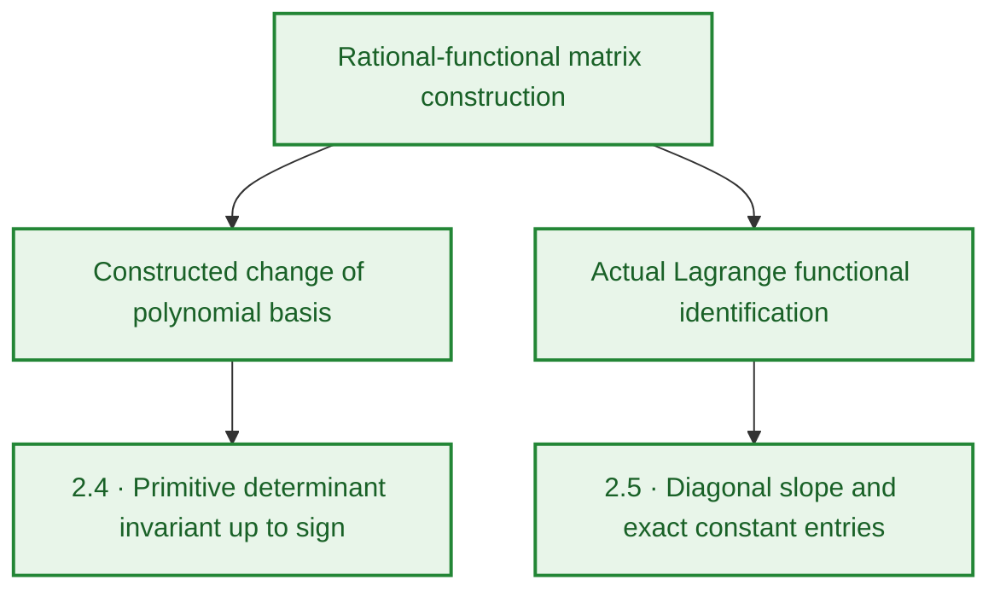
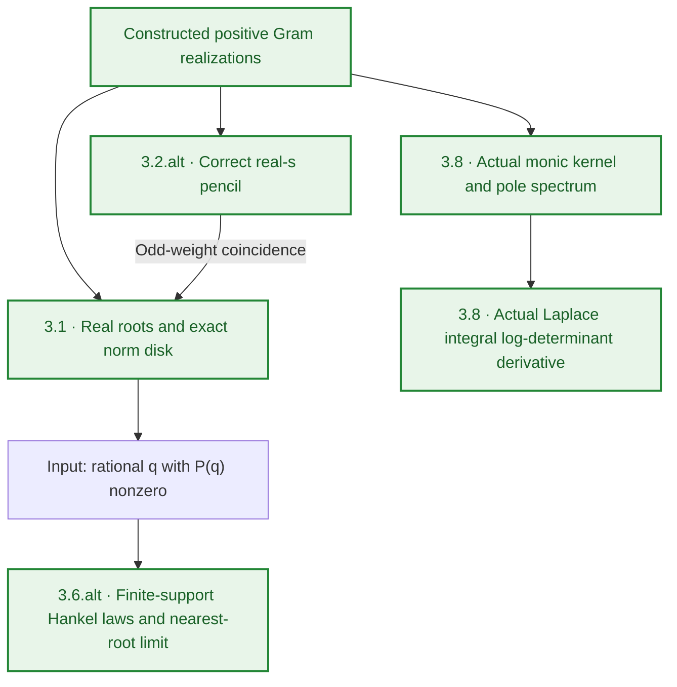
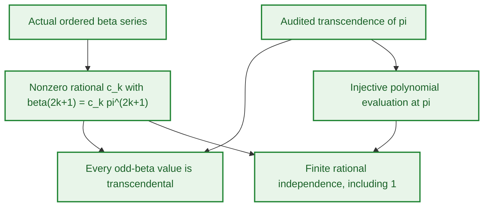
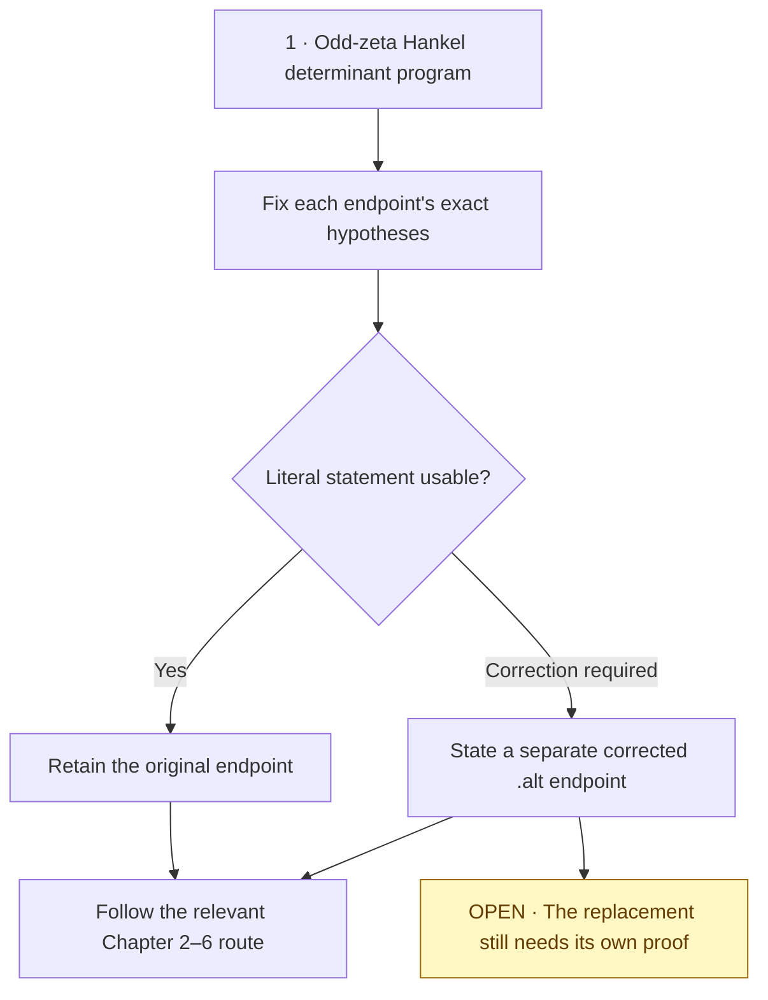
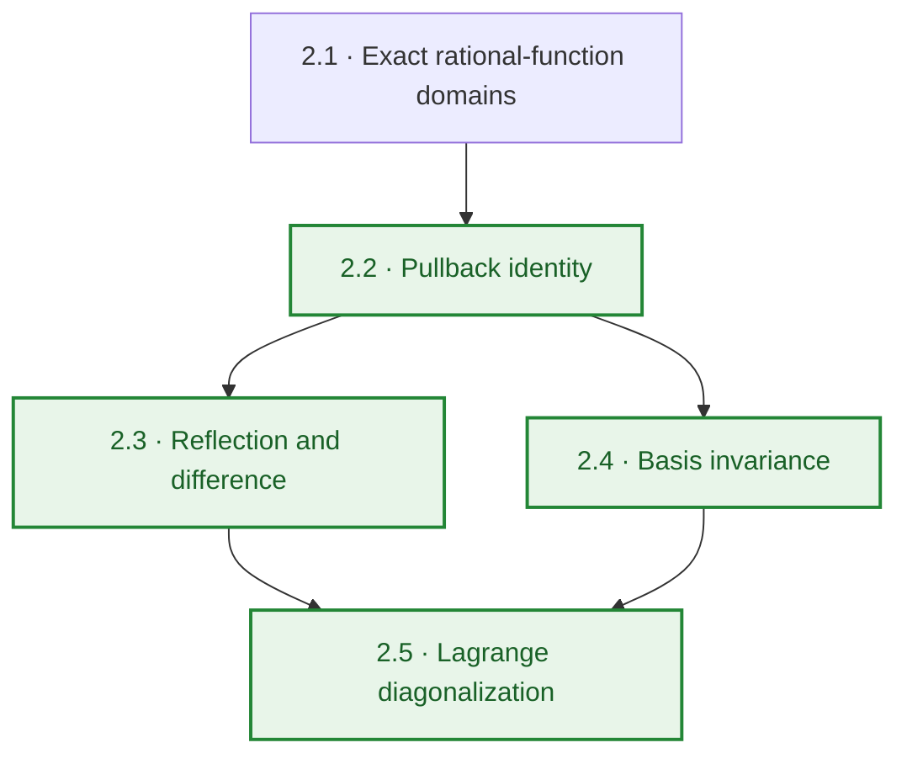
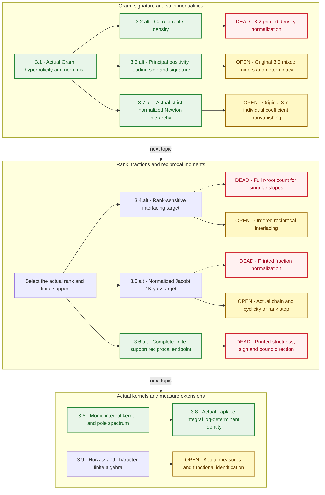
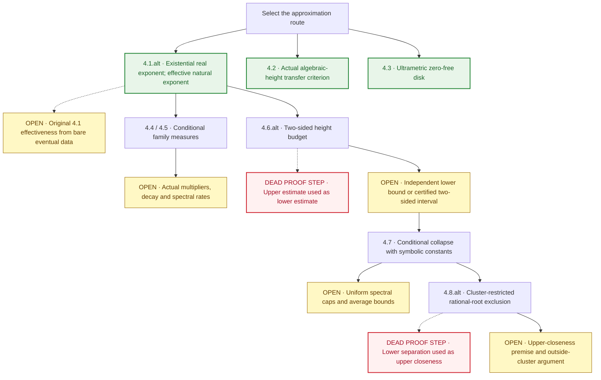
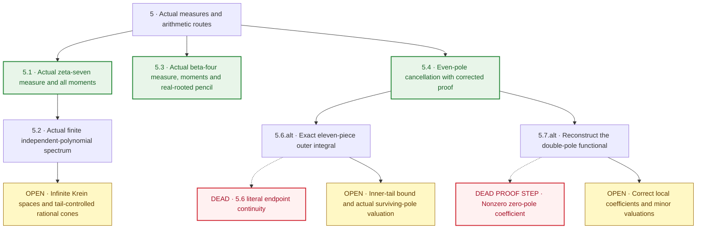
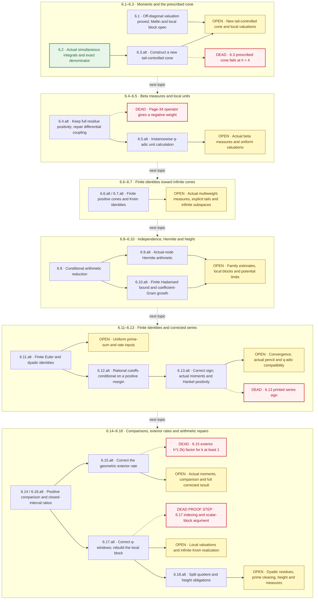

# Leaned Paper

This repository formalizes the supplied manuscript, *Spectral Theory and Diophantine Bounds for Hankel Determinants of Odd Zeta Values*, with Lean 4.33.0 and pinned Mathlib.

## Showcase — three strongest theorem chains

Selected for completed endpoints, breadth of the proved mathematics and direct connection to the manuscript. **`!! A-Tier` means the exact original or separately stated alternative has compiled and passed the transitive axiom audit.** Current receiving verification is tied to commit `7250b47ba4d20ba934e890966a9b77a559689cfd`, [GitHub Actions run 40327942655](https://github.com/randogelist/zetahyperbolic-axiom/actions/runs/40327942655), and [its matching receipt](validation/github/20261026/acceptance.json). Historical [Linux acceptance](validation/linux/acceptance.json), [axiom audit](validation/linux/proof_integrity.json) and [source inventory](provenance/active_module_hashes.json) remain historical evidence. Neither checkpoint completes the paper.

Green nodes are proved components within the stated scope. The maps summarize mathematical connections, not module import order. The full [chapter routes and deadpoints](#reading-the-chapter-flowcharts) follow below.

### 1. Exact rational functionals → canonical determinant and diagonal slope

**Original endpoints — `!!`:** the exact functional identities of **2.2–2.3**, basis invariance **2.4**, and Lagrange pole diagonalization **2.5**.

**↳ Alternative / corrected version:** retain these statements; correct the Bernoulli `B₁` proof prose in 2.3. No weakened replacement is needed.

**Payoff:** genuine polynomial bases give the same nonzero primitive determinant up to sign. For the actual Lagrange pencil, the off-diagonal entries are constant and the diagonal slopes are explicitly nonzero. The diagonalization concerns the **slope**, not the entire affine pencil. The exact hypotheses include a nonzero determinant for 2.4 and `m > 0, N ≤ K` for 2.5.

[Functional foundations](docs/SECTION2_FUNCTIONAL_COMPLETION.md) · [2.4 endpoint](src/LeanPaper/Section2FunctionalBasis.lean#L109) · [2.5 endpoint](src/LeanPaper/Section2LagrangeFunctional.lean#L232)

### 2. Positive Gram geometry → pole kernels, exact disks and nearest-root recovery

**Original routes — `!!`:** **3.1** gives the actual norm disk; **3.8** gives the actual monic orthogonal kernel, pole-spectrum representation and Laplace log-determinant derivative. The printed normalization in **3.2** and finite-support assertions in **3.6** remain blocked.

**↳ Selected corrected route — `!!`:** **3.2.alt** supplies the correctly normalized continuous extension for real `s > 1`; **3.6.alt** supplies the complete finite-support reciprocal corollary.

**Payoff:** under the manuscript's structural admissibility conditions, the actual primitive polynomial has degree `h`, real roots and an exact zero-free disk about the actual zeta value, with a root on its boundary. For its roots `ρᵢ`, counted with multiplicity, and a rational non-root `q`, set, for integers `n ≥ 1`,

$$
S_n(q)=\sum_{i=1}^{h}|\rho_i-q|^{-2n},
\qquad
S_n(q)^{-1/(2n)}\longrightarrow\min_i|\rho_i-q|.
$$

The pole kernel uses actual monic orthogonal polynomials and their integral squared norms. Its characteristic polynomial agrees with the actual symmetric normalized slope. For the paper's weight-only Laplace deformation, justified series and integral differentiation give the kernel integral for the log-determinant derivative at every positive scale. These are exact finite-family and analytic identities; uniform large-parameter decay and an odd-zeta irrationality conclusion remain open.

[3.1 endpoint](src/LeanPaper/PrimitiveNormDisk.lean#L77) · [3.2.alt and odd-weight coincidence](src/LeanPaper/ContinuousGram.lean#L232) · [3.6.alt endpoint](src/LeanPaper/CorrectedReciprocalCorollary.lean#L40) · [3.8 kernel](src/LeanPaper/Section3OrthogonalKernel.lean) · [3.8 Laplace endpoint](src/LeanPaper/LaplaceKernelJacobi.lean) · [Exact-statement review](docs/repair_reviews/semantic_38.md)

### 3. Actual odd-beta values → transcendence and finite rational independence

**Original component — `!!`:** the transcendence and finite-independence component of **6.15**, for every odd beta value including `β(1)`. The full printed 6.15 remains blocked.

**↳ Alternative / corrected version:** retain this proved component; the full **6.15.alt** still needs effective measures, corrected asymptotics and the analytic construction. Neither whole-result tier changes.

**Payoff:** for every `k ∈ ℕ`, the actual ordered series value `β(2k+1)` is transcendental over `ℚ`. For every `N ∈ ℕ`, the family

$$
\{1\}\cup\{\beta(2j+1):0\le j<N\}
$$

is linearly independent over `ℚ`. Independence uses polynomial evaluation at transcendental `π`, distinct exponents and nonzero rational coefficients; individual transcendence alone would not establish it. These are **odd-beta arithmetic endpoints**, not an odd-zeta irrationality theorem or completion of 6.15.

[Ordered-series identification](src/LeanPaper/OddBetaValues.lean#L116) · [Transcendence](src/LeanPaper/OddBetaValues.lean#L126) · [Finite independence](src/LeanPaper/OddBetaValues.lean#L132) · [π-power transfers](src/LeanPaper/OddPiPowers.lean)

## Recorded formalization status

**The paper is not fully formalized.** Some printed statements are false, and ordinary analytic and arithmetic proof obligations remain. The current receiving sources are checked by the matching GitHub CI receipt below. Remaining obligations include ordinary analytic and arithmetic constructions as well as false literal formulas; they are individually tracked in the [correction log](docs/AUTONOMOUS_CORRECTIONS.md) and [45-result repair ledger](docs/formalization_repair_status.json).

The recorded `v0_1_5_construction` Linux checkpoint contains **219 modules**, all compiled and independently audited in that historical environment. That historical 53-module increment preserved all 165 then-prior mathematical/helper sources byte for byte. The audit traverses **3,135 project declarations** and their dependencies, including private declarations; the only axioms are `propext`, `Quot.sound` and `Classical.choice`. See [acceptance](validation/linux/acceptance.json) and [proof integrity](validation/linux/proof_integrity.json). These declaration counts are not counts of manuscript theorems.

**Current GitHub CI checkpoint:** `7250b47ba4d20ba934e890966a9b77a559689cfd`, [run 40327942655](https://github.com/randogelist/zetahyperbolic-axiom/actions/runs/40327942655), verifies all **260 registered modules**, including a fresh `ALL_PROJECT_DECLARATIONS` audit and fresh negative-audit regressions. [Matching source, compiler, object and log receipt](validation/github/20261026/acceptance.json). This is a GitHub CI result; native Windows execution is not claimed.

## Paper chapters and theorem tiers

This index covers **all 45 numbered results** in the [52-page manuscript](Zetahyperbolic%20(3)%20(1)%20(1).pdf): **35 theorems, 5 propositions, 3 corollaries and 2 lemmas**. Numbering and chapter order follow the paper. Definition 2.1, Remarks 4.9, 4.10 and 5.5, and Conjecture 4.11 are listed separately below.

### Tier key and evidence boundary

| Marker | Tier | Required evidence |
| --- | --- | --- |
| `!` | B-Tier derivation | A reasoned derivation of the exact stated result, with all remaining premises explicit; not a Lean certificate. |
| `!!` | A-Tier | Exact Lean statement compiled and transitively axiom-audited, with its hypotheses and execution environment recorded. |
| `!!!` | Certified conditional closure | A certified downstream chain reducing the target to a finite, terminating checker; an accepted witness may remain outstanding. |
| `!!!!` | S-Tier | An actual accepted finite raw-data witness plus the certified transfer to the exact target. |
| `—` | No whole-result tier assigned | **Partial:** components exist; **Open:** full construction/proof outstanding; **Blocked:** the literal statement requires correction. These are work states, not extra proof tiers. |

A paper proof, a source filename, an imported candidate, or an audited helper does not automatically give the full printed result a tier. A generic conditional analytic theorem is not automatically `!!!`: the finite-checker reduction must itself be established. No whole-result `!`, `!!!` or `!!!!` is assigned by this inventory.

**Alternative/corrected-version policy:** Every numbered result must keep an `.alt` row **immediately underneath its original row**, including in future updates. An explicitly identified alternative or corrected version is an allowed development route. Record whether it retains the original statement, repairs it, restricts it, or adds hypotheses; preserve the original statement and its status. A restricted or conditional result does not establish the original, and a proposed replacement has no proof tier merely because it is listed. Each corrected endpoint needs its own exact-statement evidence before promotion. Where no replacement is needed, the alternative slot explicitly retains the original.

Five separately stated alternatives have whole-endpoint `!!` evidence: **3.2.alt, 3.3.alt, 3.6.alt, 3.7.alt and 4.1.alt**. The first and third retain historical corrected endpoints; the second and fourth are the previously specified restricted spectral and strict-Newton statements. The fifth separates the existential real-exponent transfer from the effective rational-data construction with a natural exponent. Their exact scopes are revalidated in the current CI checkpoint. None promotes its incomplete or blocked original. The original 45-item counts exclude all `.alt` rows.

**Green pair rule:** Color both item labels and titles green, with a 🟢 marker, exactly when **at least one of the original or its `.alt` entry has a whole-statement A-Tier (`!!`) certificate**. Green identifies an available route for the pair; it does not certify both statements or remove an incomplete/blocked-original label. Audited helper components alone do not qualify. There are **17 green pairs**: 2.2, 2.3, 2.4, 2.5, 3.1, 3.2, 3.3, 3.6, 3.7, 3.8, 4.1, 4.2, 4.3, 5.1, 5.3, 5.4 and 6.2. GitHub strips inline table-row styling, so both labels and titles use supported math-rendered green text plus the visible marker ([GitHub markup](https://github.com/github/markup#github-markup), [math rendering](https://docs.github.com/en/get-started/writing-on-github/working-with-advanced-formatting/writing-mathematical-expressions)).

**Coverage after the receiving audit:** **12/45 full original results** have A-Tier evidence: **2.2, 2.3, 2.4, 2.5, 3.1, 3.8, 4.2, 4.3, 5.1, 5.3, 5.4 and 6.2**. The five additions are **3.8, 4.2, 5.1, 5.3 and 6.2**; the seven historical originals remain proved. The remaining originals are **17 partial, 7 open and 9 blocked**. The two newly identified literal obstructions are **5.6 endpoint continuity** and **6.4's page-34 differential coupling**. In particular, the complete three-factor residue sign in 6.4 is valid. See the [current repair ledger](docs/formalization_repair_status.json), [correction log](docs/AUTONOMOUS_CORRECTIONS.md) and linked clause reviews. Each original row covers the whole printed statement; its immediately following alternative has a separately stated scope.

**Evidence history:** the [current semantic report](docs/FORMALIZATION_STATUS.md), [structured evidence with retained prior states](docs/formalization_status.json) and [45-item ledger](docs/manuscript_45_ledger.csv) distinguish current proofs from the unchanged historical 219-module Linux receipts. The earlier 238-module [run 40281351796](https://github.com/randogelist/zetahyperbolic-axiom/actions/runs/40281351796) and the earlier repair runs failed; they are not accepted full-project checkpoints. The later full PASS is only the exact `7250b47ba4d20ba934e890966a9b77a559689cfd` / `40327942655` receipt recorded above. A separately audited completed subset may support same-target object reuse but never a full-project PASS. All original manuscript text and proof statements remain available; corrections are documented separately.

### Chapter list

| Chapter | Title | Starts on page | Numbered results |
| --- | --- | ---: | ---: |
| 1 | Introduction | [1](Zetahyperbolic%20(3)%20(1)%20(1).pdf#page=1) | 0 |
| 2 | Algebraic Structure and Canonical Basis Invariance | [3](Zetahyperbolic%20(3)%20(1)%20(1).pdf#page=3) | 4 |
| 3 | Hyperbolicity, Total Positivity, and Spectral Structure | [7](Zetahyperbolic%20(3)%20(1)%20(1).pdf#page=7) | 9 |
| 4 | Diophantine Approximation, Heights, and Root Collapse for ζ(5) | [14](Zetahyperbolic%20(3)%20(1)%20(1).pdf#page=14) | 8 |
| 5 | Weight-Seven Integral Identities, Dual Pencils, and Double-Pole Systems | [22](Zetahyperbolic%20(3)%20(1)%20(1).pdf#page=22) | 6 |
| 6 | Structural Barriers, Multi-Weight Couplings, and Further Diophantine Advances | [29](Zetahyperbolic%20(3)%20(1)%20(1).pdf#page=29) | 18 |
| 7 | Discussion and Open Problems | [51](Zetahyperbolic%20(3)%20(1)%20(1).pdf#page=51) | 0 |

### Reading the chapter flowcharts

Each chapter has **one separate flowchart**. Solid arrows trace a selected development route, which may still end at an **OPEN** obligation. Dashed branches expose deadpoints; dashed **next topic** arrows indicate reading order only. These are work maps, not certified theorem-dependency graphs.

**Green** marks a whole original or corrected endpoint with recorded A-Tier evidence. **Amber OPEN** marks an outstanding mathematical or certification obligation. **Red DEAD** marks a failed literal statement; **red DEAD PROOF STEP** marks an invalid argument without asserting that the whole theorem is false. Neutral nodes identify selected targets or intermediate routes and confer no additional tier.

There are **17/45 endpoint pairs with an A-Tier route**: twelve full originals and five separately proved corrected/restricted alternatives. An unproved alternative remains a candidate. The tables retain each original immediately followed by its alternative, and the diagrams distinguish completed routes from their remaining deadpoints.

### Chapter 1 — Introduction

The introduction sets the program; it has no numbered theorem endpoint. Choose an exact original or a separately stated correction before following the later chapters.

### Chapter 2 — Algebraic Structure and Canonical Basis Invariance

**Selected route: 4/4 A-Tier originals.** No mathematical deadpoint is recorded for these four exact statements.

| Result | Printed title | Recorded whole-result tier / state | Proved scope, correction or open endpoint |
| --- | --- | --- | --- |
| 🟢 [$\color{green}\textsf{Lemma 2.2}$](Zetahyperbolic%20(3)%20(1)%20(1).pdf#page=4) | $\color{green}\textsf{Pullback identity}$ | **!! A — retained; CI revalidated** | Complete actual rational-functional pullback and representation independence. |
| 🟢 **↳** $\color{green}\textsf{2.2.alt}$ | $\color{green}\textsf{Alternative / corrected version: Original retained}$ | Same statement; original tier retained | Retain the actual rational-function pullback identity on the exact μ-domain. No replacement or weaker domain is required. [Source](docs/SECTION2_FUNCTIONAL_COMPLETION.md). |
| 🟢 [$\color{green}\textsf{Lemma 2.3}$](Zetahyperbolic%20(3)%20(1)%20(1).pdf#page=5) | $\color{green}\textsf{Reflection and difference identities for τ\_X}$ | **!! A — retained; CI revalidated** | Complete statement; retain the documented Bernoulli B₁ correction to its proof prose. |
| 🟢 **↳** $\color{green}\textsf{2.3.alt}$ | $\color{green}\textsf{Alternative / corrected version: Proof-corrected presentation}$ | Same statement; original tier retained | Retain the reflection and admissible-pole difference identities; repair the proof prose to retain the exceptional Bernoulli B₁ term. [Source](docs/SECTION2_FUNCTIONAL_COMPLETION.md). |
| 🟢 [$\color{green}\textsf{Theorem 2.4}$](Zetahyperbolic%20(3)%20(1)%20(1).pdf#page=6) | $\color{green}\textsf{Canonical basis invariance}$ | **!! A — retained; CI revalidated** | Complete functional/basis congruence and primitive normalization up to sign. |
| 🟢 **↳** $\color{green}\textsf{2.4.alt}$ | $\color{green}\textsf{Alternative / corrected version: Original retained}$ | Same statement; original tier retained | Retain canonical basis invariance, functional congruence and primitive normalization up to sign. No correction to the theorem is required. [Source](docs/formalization_status.json). |
| 🟢 [$\color{green}\textsf{Theorem 2.5}$](Zetahyperbolic%20(3)%20(1)%20(1).pdf#page=6) | $\color{green}\textsf{Lagrange pole diagonalization}$ | **!! A — retained; CI revalidated** | Complete diagonalization; alternative product spelling is tracked separately. |
| 🟢 **↳** $\color{green}\textsf{2.5.alt}$ | $\color{green}\textsf{Alternative / corrected version: Original retained / equivalent-formula route}$ | Same statement; original tier retained | Retain original-denominator Lagrange diagonalization. An alternative product spelling is a separate equality to prove, not a change in hypotheses or a new certificate. [Source](docs/formalization_status.json). |

### Chapter 3 — Hyperbolicity, Total Positivity, and Spectral Structure

**Selected routes: 6/9 A-Tier options** — originals 3.1 and 3.8, plus 3.2.alt, 3.3.alt, 3.6.alt and 3.7.alt. The original 3.3 and 3.7 keep their missing clauses; the corrected 3.4 and 3.5 constructions and actual 3.9 measure identifications remain open.

| Result | Printed title | Recorded whole-result tier / state | Proved scope, correction or open endpoint |
| --- | --- | --- | --- |
| 🟢 [$\color{green}\textsf{Theorem 3.1}$](Zetahyperbolic%20(3)%20(1)%20(1).pdf#page=7) | $\color{green}\textsf{Universal hyperbolicity and zero-free disk}$ | **!! A — retained; CI revalidated** | Complete actual primitive-polynomial statement and operator-norm disk; later exponential estimates are separate. |
| 🟢 **↳** $\color{green}\textsf{3.1.alt}$ | $\color{green}\textsf{Alternative / corrected version: Original retained}$ | Same statement; original tier retained | Retain exact degree, the true zeta center, real roots and the inverse-operator-norm disk. Pairwise root distinctness and exponential rates are separate targets. [Source](docs/formalization_status.json). |
| 🟢 [$\color{green}\textsf{Proposition 3.2}$](Zetahyperbolic%20(3)%20(1)%20(1).pdf#page=8) | $\color{green}\textsf{Continuous hyperbolic pencil for all real s > 1}$ | **— Blocked** | Blocked literal odd-weight coincidence: density normalization is wrong. Corrected real-s pencil is proved. |
| 🟢 **↳** $\color{green}\textsf{3.2.alt}$ | $\color{green}\textsf{Alternative / corrected version: Corrected density normalization}$ | **!! A — corrected; CI revalidated** | Replace `(2π)^s/(2Γ(s))` by `2(2π)^(s−1)/Γ(s)` in the density. The corrected continuous-real-s Gram pencil recovers exact odd-weight coincidence; the blocked original normalization remains recorded. [Source](src/LeanPaper/ContinuousGram.lean). |
| 🟢 [$\color{green}\textsf{Theorem 3.3}$](Zetahyperbolic%20(3)%20(1)%20(1).pdf#page=8) | $\color{green}\textsf{Total positivity, leading sign, and universal signature}$ | **— Partial** | Actual principal-minor positivity, residue-product leading sign and intrinsic signature are assembled in 3.3.alt. The original arbitrary mixed-minor strict positivity and Stieltjes determinacy remain unproved. |
| 🟢 **↳** $\color{green}\textsf{3.3.alt}$ | $\color{green}\textsf{Alternative / corrected version: Restricted finite spectral statement}$ | **!! A — restricted; GitHub CI** | For the actual admissible family, prove Gram and every principal-determinant positivity at the true zeta value, the exact residue-product leading coefficient/sign, and intrinsic positive/negative signature counts. The restriction excludes arbitrary mixed minors and determinacy, exactly as previously specified. [Endpoint](src/LeanPaper/Section3RestrictedSpectral.lean) · [Review](docs/repair_reviews/spectral.md). |
| [Theorem 3.4](Zetahyperbolic%20(3)%20(1)%20(1).pdf#page=9) | Root interlacing and Dodgson condensation for principal minors | **— Blocked** | Printed r-root enumeration fails for singular slopes. Rank-sensitive components and Dodgson identity are proved; full corrected interlacing remains. |
| **↳ 3.4.alt** | **Alternative / corrected version:** Rank-sensitive interlacing and condensation | — Corrected target; partial | Count roots with multiplicity by normalized-slope rank; allow zero generalized eigenvalues and take reciprocals only of nonzero ones. Restrict nearest-root distance to positive rank, or use infinity for an empty root set. Retain Dodgson condensation; full corrected interlacing remains open. [Source](docs/SPECTRAL_CONTINUATION_REVIEW.md). |
| [Corollary 3.5](Zetahyperbolic%20(3)%20(1)%20(1).pdf#page=10) | Stieltjes J-fraction from interlacing roots | **— Blocked** | Printed fraction normalization has an actual-family counterexample. Full corrected Jacobi/Lanczos construction and spectral-edge bounds remain. |
| **↳ 3.5.alt** | **Alternative / corrected version:** Normalized Jacobi / Krylov-rank fraction | — Corrected target; open | Retain `det(G_(h−1))/det(G_h)`; use diagonal terms `1+t*a_j` and off-diagonal squares `t²*b_j²`. Require a cyclic starting vector for a full strict positive off-diagonal chain; otherwise stop at Krylov rank. Quantitative edge estimates remain separate. [Source](docs/SPECTRAL_CONTINUATION_REVIEW.md). |
| 🟢 [$\color{green}\textsf{Corollary 3.6}$](Zetahyperbolic%20(3)%20(1)%20(1).pdf#page=11) | $\color{green}\textsf{Stieltjes reciprocal-root power sums}$ | **— Blocked** | Printed all-order strictness, bound orientation and odd-order sign need correction. Corrected fixed-family result is proved; it is not the original statement. |
| 🟢 **↳** $\color{green}\textsf{3.6.alt}$ | $\color{green}\textsf{Alternative / corrected version: Corrected finite-support reciprocal corollary}$ | **!! A — corrected; CI revalidated** | For a rational non-root q and `S_m(q)=Σ_j(r_j−q)^(−m)`, for m≥1 use `D^m log(abs(P))(q)=−(m−1)!S_m(q)`. Coalesce inverse-square gaps into d distinct positive atoms: Hankel matrices are PSD at every size, ordinary determinants are positive for sizes ≤d and zero beyond. For `d_min>0` and integers r≥1, the finite ratio `S_(2r)(q)^(−1/(2r))/d_min` lies in `[h^(−1/(2r)),1]` and tends to 1. This is the corrected fixed-family endpoint. [Source](docs/COROLLARY_3_6_REPAIR.md). |
| 🟢 [$\color{green}\textsf{Theorem 3.7}$](Zetahyperbolic%20(3)%20(1)%20(1).pdf#page=11) | $\color{green}\textsf{Turánian non-negativity and Newton log-concavity}$ | **— Partial** | Strict normalized Newton components are proved. Individual centered-coefficient nonvanishing still needs an actual-family argument. |
| 🟢 **↳** $\color{green}\textsf{3.7.alt}$ | $\color{green}\textsf{Alternative / corrected version: Restricted strict Newton hierarchy}$ | **!! A — restricted; GitHub CI** | Actual-family strict degree-normalized centered Newton inequalities and the exact coefficient strictness criterion are proved. The degree premise follows whenever the stated inequality range is nonempty. Individual centered-coefficient nonvanishing remains outside this previously specified alternative. [Endpoints](src/LeanPaper/ActualStrictNewton.lean) · [Review](docs/repair_reviews/spectral.md). |
| 🟢 [$\color{green}\textsf{Theorem 3.8}$](Zetahyperbolic%20(3)%20(1)%20(1).pdf#page=12) | $\color{green}\textsf{Christoffel–Darboux pole representation and Jacobi derivative identity}$ | **!! A — GitHub CI** | Both original clauses: actual monic integral orthogonality and inverse-Gram pole kernel, exact symmetric-spectrum characteristic polynomial, and the actual positive-scale Laplace integral log-determinant derivative with justified exchanges. [Statement review](docs/repair_reviews/semantic_38.md). |
| 🟢 **↳** $\color{green}\textsf{3.8.alt}$ | $\color{green}\textsf{Alternative / corrected version: Original retained}$ | Same statement; original tier retained | Retain the full original now that the actual kernel and Laplace constructions are proved; the earlier finite spectral/affine component remains available as a subresult. [Kernel](src/LeanPaper/Section3OrthogonalKernel.lean) · [Laplace endpoint](src/LeanPaper/LaplaceKernelJacobi.lean). |
| [Theorem 3.9](Zetahyperbolic%20(3)%20(1)%20(1).pdf#page=13) | Hyperbolicity for Hurwitz and Dirichlet Hankel determinants | **— Partial** | Finite Fekete positivity and pole algebra exist; actual Hurwitz/character analytic measures and pencil identification remain. |
| **↳ 3.9.alt** | **Alternative / corrected version:** Explicit analytic-premise hyperbolicity | — Proposed conditional target | Require actual positive integrable Gram realization, character-to-kernel identification and the pole-functional identity before applying hyperbolicity. These premises remain to be constructed; no extra closed-form Mellin evaluation is required by the printed integral definition. [Source](docs/SPECTRAL_CONTINUATION_REVIEW.md). |

### Chapter 4 — Diophantine Approximation, Heights, and Root Collapse for ζ(5)

**Selected routes: 3/8 A-Tier options** — 4.1.alt, 4.2 and 4.3. Alternative 4.1 separates existential thresholds for real exponents from computable thresholds using supplied effective rational data and a natural exponent. Proposition 4.2 is the exact conditional transfer criterion on actual algebraic numbers and their minimal-polynomial height; its concrete zeta-family inputs are separate. Continue the other routes with effective data, two-sided arithmetic bounds and proved upper closeness. Red proof-step nodes do not refute every conclusion of their full theorems.

| Result | Printed title | Recorded whole-result tier / state | Proved scope, correction or open endpoint |
| --- | --- | --- | --- |
| 🟢 [$\color{green}\textsf{Theorem 4.1}$](Zetahyperbolic%20(3)%20(1)%20(1).pdf#page=14) | $\color{green}\textsf{Spectral irrationality measure criterion}$ | **— Partial** | The split alternative is proved. Bare existential eventual bounds do not supply the effective onset/rate data required by the original computability assertion. |
| 🟢 **↳** $\color{green}\textsf{4.1.alt}$ | $\color{green}\textsf{Alternative / corrected version: Existential / effective-data split}$ | **!! A — corrected; GitHub CI** | Eventual degree, nonzero quadratic center-decay and root-separation bounds give an existential denominator threshold for every real μ above the strict rate ratio, also on positive lattices. The computed threshold is the separate rational-data budget with μ∈ℕ, a supplied natural onset and certified rational margins; it is not an algorithm from arbitrary unspecified real data. [Existential/lattice endpoints](src/LeanPaper/Section4TransferComplete.lean) · [Effective endpoint](src/LeanPaper/Section4EffectiveBudget.lean) · [Independent review](docs/repair_reviews/semantic_section4_alternatives.md). |
| 🟢 [$\color{green}\textsf{Proposition 4.2}$](Zetahyperbolic%20(3)%20(1)%20(1).pdf#page=15) | $\color{green}\textsf{Transfer criterion for algebraic approximations of degree d ≥ 1}$ | **!! A — GitHub CI** | Complete printed conditional transfer on the positive lattice, with the actual integer minimal polynomial, naive algebraic height, extension degree, finite upper-limsup height budget and exact claimed approximation exponent. No effective threshold or concrete zeta-family rate is added. [Independent review](docs/repair_reviews/semantic_42.md). |
| 🟢 **↳** $\color{green}\textsf{4.2.alt}$ | $\color{green}\textsf{Alternative / corrected version: Original retained}$ | Same statement; original tier retained | Retain the original criterion and its explicit degree, nonzero decay, root-separation, upper-limsup height and strict rate-gap hypotheses. These are the printed premises, not a weakened substitute for the original. [Endpoint](src/LeanPaper/Section4AlgebraicHeight.lean). |
| 🟢 [$\color{green}\textsf{Proposition 4.3}$](Zetahyperbolic%20(3)%20(1)%20(1).pdf#page=15) | $\color{green}\textsf{Ultrametric zero-free disk over Q\_p}$ | **!! A — retained; CI revalidated** | Complete abstract ultrametric disk statement; concrete zeta valuations and irrationality are separate. |
| 🟢 **↳** $\color{green}\textsf{4.3.alt}$ | $\color{green}\textsf{Alternative / corrected version: Original retained}$ | Same statement; original tier retained | Retain the open ultrametric disk for an integral p-adic center with nonzero polynomial value. No actual zeta-family identification or valuation theorem is added. [Source](docs/formalization_status.json). |
| [Theorem 4.4](Zetahyperbolic%20(3)%20(1)%20(1).pdf#page=16) | Sharpened spectral bound and effective irrationality measure for ζ(5) | **— Partial** | Actual normalization, arithmetic multiplier, determinant decay and spectral rate 11.411 remain; measure 25687 is not certified. |
| **↳ 4.4.alt** | **Alternative / corrected version:** Conditional manuscript-family measure | **— Partial** | For the exact `K=30n` integer-polynomial family, explicitly require degree ≤λK, `0<abs(Q_K(ζ(5)))≤exp(−εK²)`, root separation ≥`exp(−ρK)`, positive rates, certified rational rate margins and effective onsets. Require `λρ/ε<25687` before concluding that measure; rate 11.411 and the needed decay for this family remain unproved. [Source](docs/SECTION4_CONTINUATION_REVIEW.md). |
| [Theorem 4.5](Zetahyperbolic%20(3)%20(1)%20(1).pdf#page=18) | Irrationality and effective measure for bζ(5) + aζ(3) | **— Partial** | Actual positive-density cone, p-adic cancellation and uniform quantitative measure inputs remain. |
| **↳ 4.5.alt** | **Alternative / corrected version:** Conditional coupled-family measure | **— Partial** | For the paper's admissible a,b, require the actual coupled positive-density identity, its own arithmetic multiplier/valuation losses, and effective decay/separation bounds with the strict rate margin for the claimed measure. No unconditional coupled-family estimate is supplied. [Source](docs/SECTION4_CONTINUATION_REVIEW.md). |
| [Theorem 4.6](Zetahyperbolic%20(3)%20(1)%20(1).pdf#page=19) | Two-sided determinant bounds and coefficient heights | **— Partial** | Uniform height/decay estimates and printed constants 0.23310 and 3.73980 remain open. |
| **↳ 4.6.alt** | **Alternative / corrected version:** Two-sided arithmetic-rate repair | — Proposed quantitative repair | Retain the finite leading-coefficient/relative-determinant identity. Derive quantitative height bounds from a certified two-sided interval for the same arithmetic multiplier; an upper estimate cannot be reused as a lower estimate. The missing lower bound remains an explicit obligation. [Source](docs/SECTION4_CONTINUATION_REVIEW.md). |
| [Theorem 4.7](Zetahyperbolic%20(3)%20(1)%20(1).pdf#page=21) | Macroscopic exponential root collapse and root separation | **— Partial** | Actual closest-root existence from center decay, straddling-root separation and genuine divisor-height bounds are proved. Uniform spectral caps, actual numerical decay/height rates and same-factor separation remain. [New components](docs/repair_reviews/section4.md). |
| **↳ 4.7.alt** | **Alternative / corrected version:** Conditional collapse with symbolic constants | **— Partial** | Require uniform caps for the actual spectral logarithms and an independently proved average lower bound; derive collapse/separation with constants expressed in those inputs. Numerical family constants remain unassigned until the estimates are proved. [Source](docs/formalization_status.json). |
| [Proposition 4.8](Zetahyperbolic%20(3)%20(1)%20(1).pdf#page=21) | Rational root exclusion and degree bounds for cluster factors | **— Partial** | Actual polynomial-factor degree bounds and all-denominator cluster exclusion are proved with their exact quantitative premises. Family-wide norm/height budgets, genuine upper cluster closeness and outside-cluster exclusion remain. [Review](docs/repair_reviews/section4.md). |
| **↳ 4.8.alt** | **Alternative / corrected version:** Cluster-restricted rational-root exclusion | **— Partial** | Restrict exclusion to roots already satisfying an independently established upper cluster-closeness bound and the necessary arithmetic/height budgets. A lower separation bound does not supply that premise; roots outside the cluster require a separate exclusion argument. [Source](docs/SECTION4_CONTINUATION_REVIEW.md). |

### Chapter 5 — Weight-Seven Integral Identities, Dual Pencils, and Double-Pole Systems

**Selected route: 3/6 A-Tier originals** — 5.1, 5.3 and 5.4. Actual Beukers measures and finite polynomial pencils are constructed. Infinite Krein cones, prime-sum tails and local valuations remain separate. The literal endpoint-continuity clauses of 5.6 are false; its exact outer integral is proved without changing endpoint values.

| Result | Printed title | Recorded whole-result tier / state | Proved scope, correction or open endpoint |
| --- | --- | --- | --- |
| 🟢 [$\color{green}\textsf{Theorem 5.1}$](Zetahyperbolic%20(3)%20(1)%20(1).pdf#page=22) | $\color{green}\textsf{Two-variable Beukers measure for ζ(7)}$ | **!! A — GitHub CI** | Constructed actual positive two-variable Beukers measure, integrable monomials and both diagonal/off-diagonal moments, followed by actual rational-polynomial bilinear identification with the affine zeta-seven pencil. [Endpoint](src/LeanPaper/BeukersIntegralPencil.lean) · [Review](docs/repair_reviews/beukers.md). |
| 🟢 **↳** $\color{green}\textsf{5.1.alt}$ | $\color{green}\textsf{Alternative / corrected version: Original retained}$ | Same statement; original tier retained | Retain the full original measure and moment theorem. The finite polynomial-integral bridge is proved by integrating actual polynomial evaluations, with integrability established first. [Source](src/LeanPaper/BeukersIntegralPencil.lean). |
| [Theorem 5.2](Zetahyperbolic%20(3)%20(1)%20(1).pdf#page=23) | Dual hyperbolicity and Krein-space decomposition of the two-variable ζ(7) pencil | **— Partial** | Actual finite polynomial integral identity, positive coefficient-Gram derivative, exact degree and real spectrum are proved from rational independence. Infinite Krein spaces and tail-controlled cones remain; degree/truncation must depend on the desired dimension. |
| **↳ 5.2.alt** | **Alternative / corrected version:** Finite spectrum / corrected cone split | — Restricted finite component proved; full cone target open | The actual finite polynomial pencil has positive-definite coefficient-Gram slope, degree h and real spectrum. The separately requested corrected infinite cones still need sufficiently large K depending on h and explicit negative-tail control. The whole alternative is not promoted. [Source](src/LeanPaper/BeukersPolynomialSpectrum.lean) · [Review](docs/repair_reviews/beukers_polynomial_spectrum.md). |
| 🟢 [$\color{green}\textsf{Proposition 5.3}$](Zetahyperbolic%20(3)%20(1)%20(1).pdf#page=24) | $\color{green}\textsf{Two-variable Beukers measure and dual pencil for β(4) = L(4, χ₋₄)}$ | **!! A — GitHub CI** | Actual printed beta-four density and measure; integrable fourth-power moments with the exact diagonal and divided-difference formulas; actual rational-polynomial affine pencil with positive derivative, degree h and all roots real. [Independent statement review](docs/repair_reviews/semantic_53.md). |
| 🟢 **↳** $\color{green}\textsf{5.3.alt}$ | $\color{green}\textsf{Alternative / corrected version: Original retained}$ | Same statement; original tier retained | Retain the original with its actual constructed measure. Rational polynomials A(u) evaluated at u=x^4 represent exactly the printed Q[x^4] space; no moment-identification premise or positivity of the integral form is assumed. [Moments](src/LeanPaper/BetaBeukersMoments.lean) · [Spectrum](src/LeanPaper/BetaBeukersSpectrum.lean). |
| 🟢 [$\color{green}\textsf{Theorem 5.4}$](Zetahyperbolic%20(3)%20(1)%20(1).pdf#page=25) | $\color{green}\textsf{Cancellation of higher zeta values on even pole pairs}$ | **!! A — retained; CI revalidated** | Complete final statement; preserve the three documented sign/B₁/pole-sum proof corrections. |
| 🟢 **↳** $\color{green}\textsf{5.4.alt}$ | $\color{green}\textsf{Alternative / corrected version: Proof-corrected original retained}$ | Same statement; original tier retained | Retain the cancellation theorem on its full simple even-pole domain. Correct the reflected-pole sign, Bernoulli B₁ exception and j=1 pole-sum proof argument; do not extend it to higher-order poles without a new proof. [Source](docs/SECTION2_FUNCTIONAL_COMPLETION.md). |
| [Theorem 5.6](Zetahyperbolic%20(3)%20(1)%20(1).pdf#page=26) | Weight-seven prime-sum evaluation and pole-ordered refinement | **— Blocked** | The actual floor-function values contradict both printed endpoint-continuity clauses. All eleven affine pieces and the actual integral 453803/288000 are proved, without redefining endpoints. Inner-tail estimates and the pole-ordered q-adic refinement remain. [Review](docs/repair_reviews/beukers.md). |
| **↳ 5.6.alt** | **Alternative / corrected version:** Endpoint-corrected partition and certified-tail route | — Corrected target; exact integral component proved | Replace the false half-open continuity claims by the proved open-interval piece formulas and integrability; retain the actual endpoint values and exact integral 453803/288000. The full correction still needs uniform inner-tail bounds and surviving-pole/minor valuations. [Source](src/LeanPaper/Section5OuterPrimeIntegral.lean). |
| [Theorem 5.7](Zetahyperbolic%20(3)%20(1)%20(1).pdf#page=28) | Simultaneous double-pole Hankel determinant for {1, ζ(5), ζ(6)} | **— Partial** | The displayed numerator cancels the pole at zero, so its printed nonzero double-pole coefficient is impossible. This refutes the partial-fraction bridge, not automatically the full conditional valuation conclusion. Reconstruct the actual double-pole functional and local minor estimates. [Diagnostic](src/LeanPaper/DoublePoleZeroCoefficientObstruction.lean). |
| **↳ 5.7.alt** | **Alternative / corrected version:** Local-arithmetic conditional determinant | — Proposed conditional target | Construct the actual double-pole Hermite determinant; make its local coefficient nonvanishing and minor-valuation requirements explicit before deriving the stated q-adic valuation. These arithmetic requirements remain open. [Source](docs/SECTION56_CONTINUATION_REVIEW.md). |

### Chapter 6 — Structural Barriers, Multi-Weight Couplings, and Further Diophantine Advances

**Selected route: 1/18 full A-Tier original** — 6.2, the actual simultaneous Beukers functional with exact denominator clearing. The valid full three-factor residue sign in 6.4 is retained; its page-34 differential coupling needs a separate sign/normalization repair. The prescribed 6.3 cone is refuted, and the 6.17 proof-step failures leave its full conditional theorem unresolved. Odd-beta arithmetic in the top showcase remains a component of 6.15.

| Result | Printed title | Recorded whole-result tier / state | Proved scope, correction or open endpoint |
| --- | --- | --- | --- |
| [Theorem 6.1](Zetahyperbolic%20(3)%20(1)%20(1).pdf#page=29) | Divided-difference p-adic valuation law and intrinsic p⁻⁶ barrier | **— Partial** | Actual outer-prime off-diagonal valuation −7, congruence reduction and Beukers-integral identification are proved. Mellin disintegration and the full local two-by-two leading-congruence obstruction remain. [Source](src/LeanPaper/BeukersOuterValuation.lean). |
| **↳ 6.1.alt** | **Alternative / corrected version:** Separate analytic identity and local obstruction | — Partial; off-diagonal arithmetic proved | Retain the exact prime/index conditions. The actual off-diagonal valuation is now proved without a valuation premise; the two-variable/Mellin identity and full local obstruction block remain separate. This does not certify the whole barrier theorem. [Source](src/LeanPaper/BeukersOuterValuation.lean). |
| 🟢 [$\color{green}\textsf{Theorem 6.2}$](Zetahyperbolic%20(3)%20(1)%20(1).pdf#page=31) | $\color{green}\textsf{Simultaneous weight-(6, 7) Beukers functional with zero denominator overhead}$ | **!! A — GitHub CI** | Complete actual-measure simultaneous zeta-six/zeta-seven polynomial identity, integrability and justified series exchange, exact printed harmonic diagonal/off-diagonal rational part, and clearing by 6*d_K^7 for integral coefficients. [Endpoint](src/LeanPaper/BeukersSimultaneous.lean) · [Review](docs/repair_reviews/section6.md). |
| 🟢 **↳** $\color{green}\textsf{6.2.alt}$ | $\color{green}\textsf{Alternative / corrected version: Original retained}$ | Same statement; original tier retained | Retain the full original. Both the actual extra-denominator integral and the printed rational-part expansion are proved; denominator clearing is not used as a substitute for the analytic identity. [Source](src/LeanPaper/BeukersSimultaneous.lean). |
| [Theorem 6.3](Zetahyperbolic%20(3)%20(1)%20(1).pdf#page=32) | Unconditional q-adic non-vanishing and explicit positive-cone approximations for G_A⁽⁷⁾(X) | **— Blocked** | Part (2) has an exact rational/analytic h=4 counterexample, explicitly not a Lean proof. New cone/tail construction is needed; part (1) q-adic proof remains. |
| **↳ 6.3.alt** | **Alternative / corrected version:** New tail-controlled positive cone | — Proposed corrected construction; open | Replace the refuted fixed `m₀=2h, K=7h` cone by a newly constructed subspace whose negative-tail quadratic contribution has magnitude uniformly smaller than the retained positive spectral margin. Choose degree/truncation from that bound and reprove dimension, positivity and decay; q-adic part (1) remains separate. [Source](docs/BEUKERS_POSITIVITY_COUNTEREXAMPLE.md). |
| [Theorem 6.4](Zetahyperbolic%20(3)%20(1)%20(1).pdf#page=33) | Character–Vandermonde sign cancellation and unconditional hyperbolicity for β(4) | **— Blocked** | On page 34, the printed operator D−(4/π²)D³ gives −π*y^4*sinh(π*y/2)/(16*cosh(π*y/2)^4), negative for y>0, contrary to its positive displayed formula. The complete three-factor residue sign is valid and proved. Actual beta functional/pencil identification still remains. [Review](docs/repair_reviews/section6.md). |
| **↳ 6.4.alt** | **Alternative / corrected version:** Corrected differential coupling with original residue positivity | — Corrected target; exact finite corrections proved | Multiply the page-34 differential expression by −π to recover its printed positive π² closed form. Retain the literal odd-square prefix/derivative/character residue formula: all three signs cancel, without changing orientation. This does not complete the analytic functional or identify its slope. The page-33 signed density is a separate formula. [Derivative correction](src/LeanPaper/BetaCouplingDerivative.lean) · [Actual residues](src/LeanPaper/BetaOddResidueSigns.lean). |
| [Theorem 6.5](Zetahyperbolic%20(3)%20(1)%20(1).pdf#page=34) | Unconditional q-adic non-vanishing for Δ_K(0) | **— Open** | Exact stated local residue/minor arithmetic and v_q(Δ_K(0)) = −(3m_q − 2) remain. |
| **↳ 6.5.alt** | **Alternative / corrected version:** Instancewise q-adic unit certificates | — Proposed restricted arithmetic target | For each permitted parameter instance, establish that the actual suitably scaled determinant is a q-adic unit by exact residue/minor calculations. A family-wide valuation formula requires a uniform proof of those certificates. [Source](docs/SECTION56_CONTINUATION_REVIEW.md). |
| [Theorem 6.6](Zetahyperbolic%20(3)%20(1)%20(1).pdf#page=35) | Generalized multi-weight positive-definite pencil | **— Partial** | Actual infinite density, uniform two-sided comparison, arithmetic multiplier and signature/asymptotics remain. |
| **↳ 6.6.alt** | **Alternative / corrected version:** Finite positive-cone restriction | — Restricted target; finite components recorded | Use a finite nonnegative combination of positive-semidefinite matrices with a strictly positive coefficient on a positive-definite anchor. This targets finite positivity/spectral consequences only; the actual infinite multiweight density, arithmetic and asymptotics remain outside the restriction. [Source](docs/formalization_status.json). |
| [Theorem 6.7](Zetahyperbolic%20(3)%20(1)%20(1).pdf#page=37) | Universal multi-weight two-variable Beukers Krein decomposition | **— Open** | Actual signed multiweight measure, infinite Krein subspaces and arithmetic nonvanishing remain. |
| **↳ 6.7.alt** | **Alternative / corrected version:** Finite Krein identity with explicit tail | — Proposed restricted target | Establish the actual finite polynomial Krein identity with a stated remainder/tail term. Infer infinite positive/negative subspaces only after proving tail control and the required rational constructions. [Source](docs/SECTION56_CONTINUATION_REVIEW.md). |
| [Corollary 6.8](Zetahyperbolic%20(3)%20(1)%20(1).pdf#page=38) | Unconditional three-term linear independence cone for {1, ζ(3), ζ(5)} | **— Open** | Actual cone/approximants and nonvanishing, height and decay estimates remain. |
| **↳ 6.8.alt** | **Alternative / corrected version:** Conditional cone-specific independence | — Proposed conditional target | Make the actual nonvanishing, height and decay inputs from 4.5 explicit, and treat the b=0 Apéry branch separately. The proposed reduction does not establish unconditional three-term independence. [Source](docs/SECTION56_CONTINUATION_REVIEW.md). |
| [Theorem 6.9](Zetahyperbolic%20(3)%20(1)%20(1).pdf#page=38) | Triple-pole and multi-weight Hankel determinants | **— Partial** | Finite Hermite/jet components exist; global pole order, actual-node invertibility/nonzero factors and q-adic transfer remain. |
| **↳ 6.9.alt** | **Alternative / corrected version:** Actual-node Hermite / local-valuation split | — Restricted target; finite components recorded | Prove confluent Hermite-table invertibility for the actual distinct nodes and retain exact local coefficients. The q-adic determinant conclusion additionally requires their proved valuations, nonvanishing and leading-block domination. [Source](docs/SECTION56_CONTINUATION_REVIEW.md). |
| [Theorem 6.10](Zetahyperbolic%20(3)%20(1)%20(1).pdf#page=39) | Universal potential-gap identity and vanishing of quadratic derivative growth in two variables | **— Partial** | Finite determinant identities, the exact coefficient-height Hadamard bound from LDL, and integer coefficient-Gram quadratic-growth limit are proved. Actual one-variable equilibrium-potential limits and their strict gap remain. [Review](docs/repair_reviews/section6.md). |
| **↳ 6.10.alt** | **Alternative / corrected version:** Finite identity / coefficient-Gram growth split | — Growth component proved; full split target open | Retain the exact finite identity and the proved log(det(C_K C_Kᵀ))/K²→0 for full-row-rank integer matrices with h(K)≤K+1 and fixed polynomial entry growth. The actual one-variable potential limits and strict equilibrium gap remain separate. [Source](src/LeanPaper/CoefficientGramGrowth.lean). |
| [Theorem 6.11](Zetahyperbolic%20(3)%20(1)%20(1).pdf#page=40) | The p⁻⁽²ᵏ⁻¹⁾ distribution growth law and 2-adic polynomial-quotient obstruction for β(2k) | **— Open** | Euler distribution, local-prime growth, archimedean rate independence and exact dyadic quotient obstruction remain. |
| **↳ 6.11.alt** | **Alternative / corrected version:** Finite identities before uniform distribution growth | — Proposed restricted / conditional target | Establish the exact finite Euler-distribution and polynomial-quotient identities first. Add quantitative prime-sum and uniform rate inputs before asserting distribution growth in k or the complete dyadic obstruction. [Source](docs/SECTION56_CONTINUATION_REVIEW.md). |
| [Theorem 6.12](Zetahyperbolic%20(3)%20(1)%20(1).pdf#page=42) | Full-dimension sign-flip restoration of positive definiteness and q-adic non-vanishing for pure β(4) | **— Open** | Actual sign-flipped pencil, rational cutoffs, full Gram positivity and exact q-adic nonvanishing remain. |
| **↳ 6.12.alt** | **Alternative / corrected version:** Positive-margin rational-cutoff construction | — Proposed conditional construction | Start from the actual continuous Gram matrix with a proved positive margin. Use continuity to choose rational cutoffs preserving positivity, and prove q-adic compatibility separately. Neither the required margin nor that arithmetic compatibility is assumed established. [Source](docs/SECTION56_CONTINUATION_REVIEW.md). |
| [Theorem 6.13](Zetahyperbolic%20(3)%20(1)%20(1).pdf#page=43) | Central-factorial secant differential identity, Laplace mode annihilation, and unilateral (h, 0) root signature for all k ≥ 1 | **— Blocked** | Printed series sign is wrong. Corrected differential identity, exponential envelope, every actual density moment and all finite Hankel positivity are proved. Differentiated infinite-series, beta-functional identification and full pencil/signature clauses remain. |
| **↳ 6.13.alt** | **Alternative / corrected version:** Sign-corrected series and separate analytic closure | — Corrected target; actual moment construction proved | Reverse the displayed series-product factors or insert (−1)^(k−1), retaining the positive differential closed form. The actual density now has all moments, an explicit factorial bound and positive definite Hankel matrices. Corrected termwise series differentiation, beta-functional/pencil identification and nonscalar/strict-Newton clauses still need proof. [Source](src/LeanPaper/CentralFactorialMoments.lean) · [Review](docs/repair_reviews/section6.md). |
| [Theorem 6.14](Zetahyperbolic%20(3)%20(1)%20(1).pdf#page=45) | Even-pole scaling via cosh(2πv) and coupled positive-definite pencils for bζ(5) + aβ(4) and bζ(5) − aβ(2) | **— Open** | Actual even-pole/cosh moments, comparison constants, coupled pencil and exponential disk estimates remain. |
| **↳ 6.14.alt** | **Alternative / corrected version:** Comparison-conditional coupled pencil | — Proposed conditional target | Require the actual even-pole/cosh moment identities and global positive upper/lower comparison bounds before transferring finite coupled-pencil hyperbolicity. Uniform analytic comparison and quantitative exponential disks remain open. [Source](docs/SECTION56_CONTINUATION_REVIEW.md). |
| [Theorem 6.15](Zetahyperbolic%20(3)%20(1)%20(1).pdf#page=46) | Arithmetic transcendence, strictly positive one-variable measure, and rank-one Padé pencil for β(2k + 1) across all k ≥ 0 | **— Blocked** | Odd-beta transcendence/independence components are proved. Printed exterior h⁻²ᵏ asymptotic needs correction; effective measures and full rank-one construction remain. |
| **↳ 6.15.alt** | **Alternative / corrected version:** Corrected arithmetic / rank-one asymptotic split | — Corrected target; arithmetic component recorded | Retain audited odd-beta transcendence/independence. Use `η(1)=log 2` at k=0. For fixed k,N, target root-gap asymptotic `∼ C(k,N)*(3+2√2)^(−2h)` with `C(k,N)>0`, deleting `h^(−2k)`. The documented analytic asymptotic argument is not a Lean certificate; effective measures remain separate. [Source](docs/SECTION56_CONTINUATION_REVIEW.md). |
| [Theorem 6.16](Zetahyperbolic%20(3)%20(1)%20(1).pdf#page=47) | Generalized multi-weight Zeta–Beta positive-definite pencil | **— Open** | Compact-ratio helper is integrated; actual combined density, moment identity, cone/signature and quantitative arithmetic theorem remain. |
| **↳ 6.16.alt** | **Alternative / corrected version:** Closed-interval ratio comparison restriction | — Restricted target; helper recorded | Require a continuous ratio strictly positive on the entire closed interval [0,1], including both endpoints, plus the actual weight-ratio identity and a nonnegative comparison weight. The compactness helper does not identify the mixed Zeta–Beta density or prove its arithmetic clauses. [Source](docs/TARGET_6_16_COMPACT_RATIO_FREEZE.md). |
| [Theorem 6.17](Zetahyperbolic%20(3)%20(1)%20(1).pdf#page=48) | Universal two-variable Beukers Zeta–Beta pencil, Krein decomposition, and q-adic non-vanishing | **— Partial** | Corrected prime-window components exist; repair local-block inferences and construct coupled measures/infinite Krein spaces. Full theorem is not refuted by those diagnostics alone. |
| **↳ 6.17.alt** | **Alternative / corrected version:** Corrected odd-pole windows, new local block | — Restricted correction; full theorem open | Use the documented integer windows for odd q≥3: `h=⌊(q+1)/4⌋`, `shift=⌊(q+3)/4⌋`, `degree=(q−1)/2`, isolating no lower q-pole and one upper q-pole. Recompute the actual leading block and allowed primes separately; window correction alone does not establish the determinant valuation or infinite Krein theorem. [Source](docs/TARGET_6_17_Q_WINDOW_FREEZE.md). |
| [Theorem 6.18](Zetahyperbolic%20(3)%20(1)%20(1).pdf#page=49) | Principal-minor 2-adic integrality law, dyadic height bounds for Zeta–Beta pencils, and multi-weight effective measures | **— Partial** | Quotient disappearance and exact degree components are proved; dyadic residues, determinant height loss, odd-prime multipliers and measure remain. |
| **↳ 6.18.alt** | **Alternative / corrected version:** Exact quotient restriction / conditional arithmetic | — Restricted target; degree components recorded | Retain sub-threshold quotient disappearance, the 6n leading-block specialization and degree bound 42n−1. Require residue integrality, odd-prime clearing and determinant-height budgets separately for any arithmetic or irrationality-measure transfer. [Source](docs/SECTION56_CONTINUATION_REVIEW.md). |

### Chapter 7 — Discussion and Open Problems

This chapter has no numbered theorem endpoint. Its open problems return to the unfinished routes above; the final proof-and-audit gates describe future work and grant no new tier.

### Definitions, remarks and conjecture

| Item | Topic | Status |
| --- | --- | --- |
| [Definition 2.1](Zetahyperbolic%20(3)%20(1)%20(1).pdf#page=3) | Order-s rational moment functional | Definition/construction; not one of the 45 proof-bearing results. |
| **↳ 2.1.alt** | **Alternative / corrected version:** Construction-first presentation | Retain the definition and expose the exact rational-function domain and constructed linear maps before generator formulas; this is a presentation route, not a new theorem tier. |
| [Remark 4.9](Zetahyperbolic%20(3)%20(1)%20(1).pdf#page=22) | Spectral bounds and variational conjecture for ρ₅* | Explanatory discussion; no theorem tier assigned. |
| **↳ 4.9.alt** | **Alternative / corrected version:** Separate bound and variational target | Keep proved spectral bounds separate from the variational conjecture; any proposed improved bound has its own assumptions and proof obligation. |
| [Remark 4.10](Zetahyperbolic%20(3)%20(1)%20(1).pdf#page=22) | Lee–Yang phase transition at ζ(5) | Explanatory discussion; no theorem tier assigned. |
| **↳ 4.10.alt** | **Alternative / corrected version:** Explicit heuristic interpretation | Present the phase-transition language as interpretation unless a precise asymptotic statement and proof are supplied; no theorem tier is assigned. |
| [Conjecture 4.11](Zetahyperbolic%20(3)%20(1)%20(1).pdf#page=22) | Existence of the asymptotic spectral-growth limit and equality to the variational value | Open conjecture; no proof tier assigned. |
| **↳ 4.11.alt** | **Alternative / corrected version:** Weaker one-sided asymptotic target | As a proposed intermediate target, seek explicit limsup/liminf bounds before limit existence or equality to the variational value. Such bounds would not prove the original conjecture. |
| [Remark 5.5](Zetahyperbolic%20(3)%20(1)%20(1).pdf#page=25) | Simple-pole scope of the even-pole cancellation formula | Scope restriction; higher-order poles require additional work. |
| **↳ 5.5.alt** | **Alternative / corrected version:** Higher-pole extension kept separate | Retain the simple-pole restriction; formulate higher-order poles as a new Hermite-jet extension with its own coefficient identities and proof obligations. |

Chapters 1 and 7 contain the introduction and open-problem discussion, respectively, with no additional numbered theorem statements. The chapter tables preserve the manuscript's gap at 5.5 because that item is a remark.

## Verified mathematics at the recorded baseline

| Development | Exact contribution |
| --- | --- |
| [Rational functionals](docs/SECTION2_FUNCTIONAL_COMPLETION.md) | Actual linear maps on the exact rational-function domains, literal pullback/reflection/difference and even-pole cancellation, including real iterated derivatives. |
| [Basis transport](src/LeanPaper/Section2FunctionalBasis.lean) and [Lagrange functional](src/LeanPaper/Section2LagrangeFunctional.lean) | Arbitrary functional and polynomial-basis invariance; original-denominator functional identification and complete pole diagonalization. |
| [Continuous Gram pencil](src/LeanPaper/ContinuousGram.lean) | Real-s convergence, all moments, positive Gram and hyperbolicity; corrected odd-weight coincidence. The original normalization mismatch is separately proved. |
| [Strict Newton hierarchy](src/LeanPaper/ActualStrictNewton.lean) | Actual-family strict normalized coefficient/centered inequalities, using proved distinct roots from alternating residue signs. Individual centered-coefficient nonvanishing remains separate. |
| [Corrected reciprocal corollary](docs/COROLLARY_3_6_REPAIR.md) | All-order rationality/logarithmic identities, exact finite-support Hankel laws, corrected bounds and nearest-root limit. |
| [Spectral reconstruction](docs/SPECTRAL_CONTINUATION_REVIEW.md) | Actual residue signs, mixed spectrum and intrinsic inertia, all-rank Dodgson identity, and an actual-family counterexample to the printed fraction. |
| [Arithmetic transfer](docs/SECTION4_CONTINUATION_REVIEW.md) | Constructed resultants and conjugate bounds, asymptotic index budgets, rational transfer and an explicit computable threshold from effective input data. |
| [Odd beta values](src/LeanPaper/OddBetaValues.lean) | Actual ordered beta series, nonzero rational pi-power values, transcendence and finite rational linear independence, using a pinned fully audited Lindemann proof. |
| [Section 5–6 components](docs/SECTION56_CONTINUATION_REVIEW.md) | Central-factorial differential identity and exponential envelope, Mellin/log moments, common denominators, exact quotient thresholds and arithmetic obstruction diagnostics. |

The new [Beukers counterexample](docs/BEUKERS_POSITIVITY_COUNTEREXAMPLE.md) disproves Theorem 6.3(2) for its actual `h=4` polynomial subspace. Its exact rational certificate and elementary analytic enclosure have been independently reviewed; this certificate is explicitly distinguished from a Lean kernel proof.

## Build and verify

The pinned toolchain is **Lean 4.33.0**, and Mathlib is **`db584cd6d46c92f209a44c0f1c829460d327499d`**. All transitive dependencies are locked in `lake-manifest.json`. See [BUILD.md](docs/BUILD.md) for the sequential Lake build and [LOCAL_TESTING.md](docs/LOCAL_TESTING.md) for the fingerprinted local runner.

`modules.txt` is the complete dependency-ordered active build plan, ending with `LeanPaper.KernelAudit`. The GitHub workflow validates the complete source inventory and compiles independent modules concurrently, skipping only descendants of failed modules. It records each module's source/import/object/log fingerprints and runs the independent transitive axiom gate. Reuse is restricted to matching objects from an accepted same-target audit; the global audit and negative regressions always run freshly. A failed full project can cache only a separately audited completed dependency-closed subset, and its overall result remains FAIL. A workflow configuration or previous successful run does not certify a new commit; consult that commit's actual Actions results.

The original offline Windows `run.cmd` remains unchanged; [NATIVE_RUNNER.md](docs/NATIVE_RUNNER.md) documents it. Native Windows execution has not been performed here. Deliberate negative audit fixtures under `tests/axiom_walk` are not imported into the proof development.

## Provenance and open work

[Historical increment provenance](provenance/completion_increment.json) records the earlier accepted source hashes and audit receipt. The current receiving checkpoint is identified separately by `7250b47ba4d20ba934e890966a9b77a559689cfd`, [run 40327942655](https://github.com/randogelist/zetahyperbolic-axiom/actions/runs/40327942655), and [its matching receipt](validation/github/20261026/acceptance.json). The [external pi intake](provenance/external_pi_intake.json) records the exact source commit, license, port adjustments and dependency closure. Earlier source and build evidence is retained.

The remaining work includes mixed-minor positivity and determinacy, corrected ordered interlacing and Jacobi chains, actual Hurwitz/character and higher coupled-weight functional identifications, infinite Krein constructions with proved tails, and substantial family-specific spectral, denominator, height and decay estimates. The actual 3.8 Laplace identities and the 5.1/5.3/6.2 Beukers measure chains are completed at the recorded CI checkpoint. False formulas and remaining proof-step obstructions are documented separately. No full-paper or odd-zeta irrationality claim is inferred from compilation.

The frozen workflow identifiers remain `YOU_ARE_GOODWORKFLOWFRONTIER`, `LEAN_ANCHORINGS`, and `ZETA_HYPERBOLIC_ANCHOR_1` through `ZETA_HYPERBOLIC_ANCHOR_7`.
