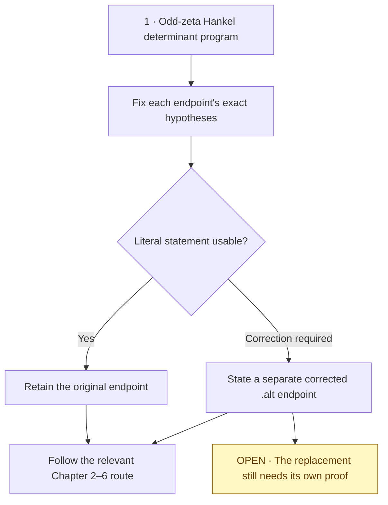
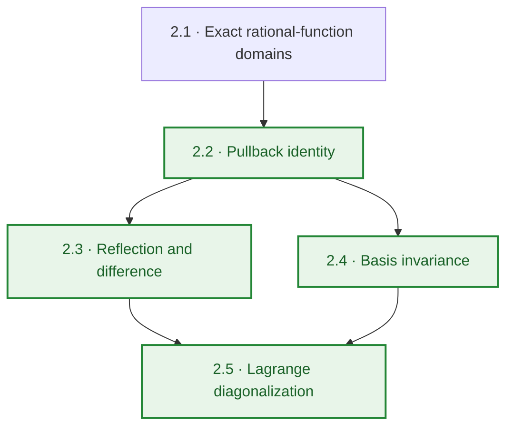
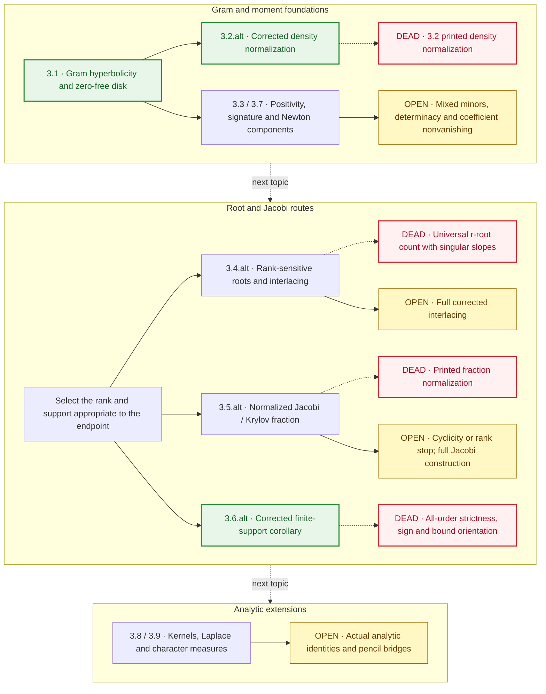
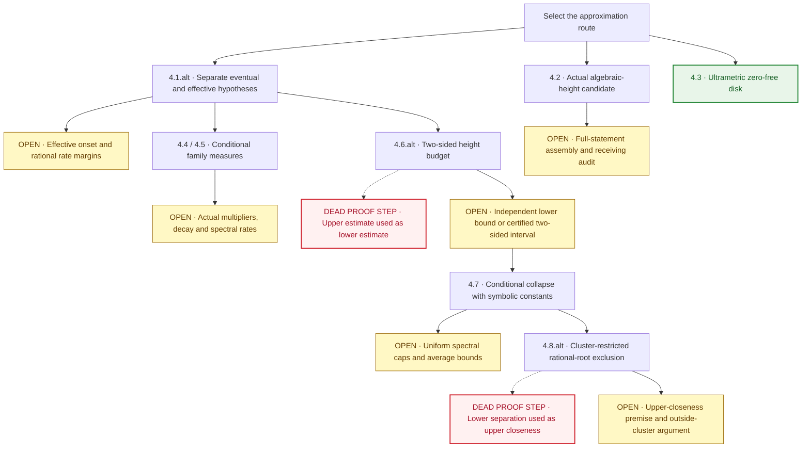
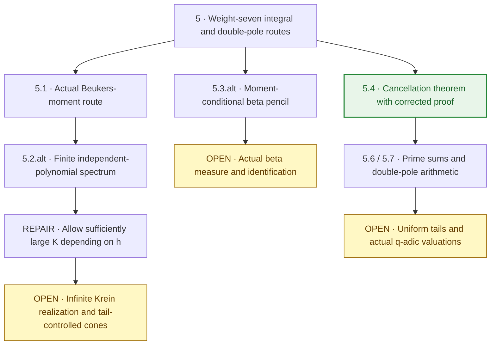
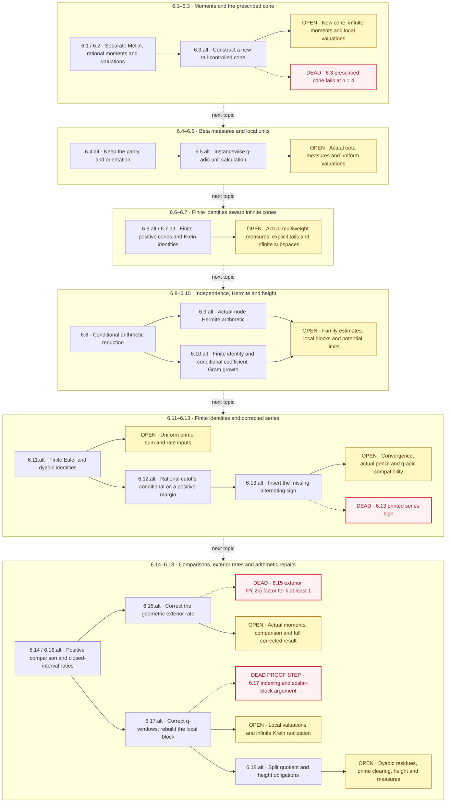
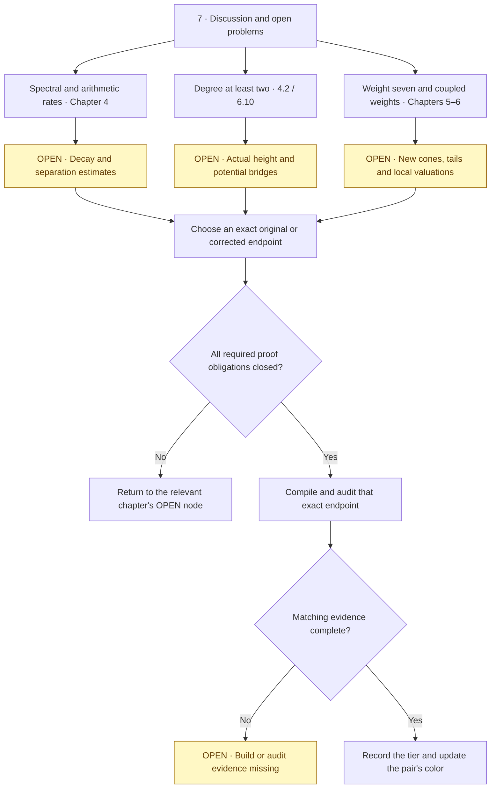

# Leaned Paper

This repository formalizes the supplied manuscript, *Spectral Theory and Diophantine Bounds for Hankel Determinants of Odd Zeta Values*, with Lean 4.33.0 and pinned Mathlib.

**The paper is not fully formalized.** Some printed statements are false, and ordinary analytic and arithmetic proof obligations remain. The repository retains verified continuation checkpoints alongside later source integrations; it is not a claim that only fatal blockers remain.

The recorded `v0_1_5_construction` Linux checkpoint contains **219 modules**, all compiled and independently audited in that historical environment. The 53 new modules preserve all 165 prior mathematical/helper sources byte for byte. The audit traverses **3,135 project declarations** and their dependencies, including private declarations; the only axioms are `propext`, `Quot.sound` and `Classical.choice`. See [acceptance](validation/linux/acceptance.json) and [proof integrity](validation/linux/proof_integrity.json). These declaration counts are not counts of manuscript theorems.

## Paper chapters and theorem tiers

This index covers **all 45 numbered results** in the [52-page manuscript](Zetahyperbolic%20(3)%20(1)%20(1).pdf): **35 theorems, 5 propositions, 3 corollaries and 2 lemmas**. Numbering and chapter order follow the paper. Definition 2.1, Remarks 4.9, 4.10 and 5.5, and Conjecture 4.11 are listed separately below.

### Tier key and evidence boundary

| Marker | Tier | Required evidence |
| --- | --- | --- |
| `!` | B-Tier derivation | A reasoned derivation of the exact stated result, with all remaining premises explicit; not a Lean certificate. |
| `!!` | A-Tier | Exact Lean statement compiled and transitively axiom-audited, with its hypotheses and execution environment recorded. |
| `!!!` | Certified conditional closure | A certified downstream chain reducing the target to a finite, terminating checker; an accepted witness may remain outstanding. |
| `!!!!` | S-Tier | An actual accepted finite raw-data witness plus the certified transfer to the exact target. |
| `—` | No whole-result tier assigned | **Partial:** components exist; **Open:** full construction/proof outstanding; **Blocked:** the literal statement requires correction. These are work states, not extra proof tiers. |

A paper proof, a source filename, an imported candidate, or an audited helper does not automatically give the full printed result a tier. A generic conditional analytic theorem is not automatically `!!!`: the finite-checker reduction must itself be established. No whole-result `!`, `!!!` or `!!!!` is assigned by this inventory.

**Alternative/corrected-version policy:** Every numbered result must keep an `.alt` row **immediately underneath its original row**, including in future updates. An explicitly identified alternative or corrected version is an allowed development route. Record whether it retains the original statement, repairs it, restricts it, or adds hypotheses; preserve the original statement and its status. A restricted or conditional result does not establish the original, and a proposed replacement has no proof tier merely because it is listed. Each corrected endpoint needs its own exact-statement evidence before promotion. Where no replacement is needed, the alternative slot explicitly retains the original.

The two `!!` corrected entries below (3.2.alt and 3.6.alt) refer to existing historical Linux evidence for those corrected endpoints; they do not promote the blocked originals or certify the current receiving tree. The original 45-item counts below exclude all `.alt` rows.

**Green pair rule:** Color both item labels and titles green, with a 🟢 marker, exactly when **at least one of the original or its `.alt` entry has a recorded whole-statement A-Tier (`!!`) certificate**. Update this formatting whenever either entry's tier changes. Green marks an available A-Tier route for the pair; it does not certify both statements, remove a blocked-original label, or upgrade historical Linux evidence to a current Windows/CI PASS. Audited helper components alone do not qualify. There are currently **9 green pairs**: 2.2, 2.3, 2.4, 2.5, 3.1, 3.2, 3.6, 4.3 and 5.4. GitHub strips inline table-row styling, so the catalog uses supported math-rendered green text plus the visible marker ([GitHub markup](https://github.com/github/markup#github-markup), [math rendering](https://docs.github.com/en/get-started/writing-on-github/working-with-advanced-formatting/writing-mathematical-expressions)).

**Recorded baseline:** seven full printed results have `!!` A-Tier evidence in the **historical Linux Lean 4.33.0** checkpoint: **2.2, 2.3, 2.4, 2.5, 3.1, 4.3 and 5.4**. The baseline ledger records another **21 partial, 10 open and 7 blocked** results. See [the semantic status report](docs/FORMALIZATION_STATUS.md), [structured evidence](docs/formalization_status.json), [all 45 ledger entries](docs/manuscript_45_ledger.csv), [Linux acceptance](validation/linux/acceptance.json) and [transitive axiom audit](validation/linux/proof_integrity.json). Each original-row tier applies to the **whole original statement**; its following `.alt` row records the alternative's separate scope and status.

**Receiving-tree checkpoint — 2026-10-26:** inspected `main@211b362c16ff6ef73e9a5f2f70c5cbb9a444cf80` registers **238 modules**, whereas the retained Linux receipt covers **219 modules**. Its [Actions run 40281351796](https://github.com/randogelist/zetahyperbolic-axiom/actions/runs/40281351796) failed at the compile/audit step. The seven historical tiers are preserved; this is **not** a successful 238-module audit or a native Windows PASS. Source integrations for [3.3 / 5.1 / finite 5.2](docs/GWF_MANUSCRIPT_234_CLEAN_MAIN_INTAKE_20261026.md), [4.2](docs/GWF_SECTION4_ALGEBRAIC_HEIGHT_SOURCE_INTAKE_20261026.md), [5.2 rational independence](docs/GWF_SECTION52_RATIONAL_POLYNOMIAL_INDEPENDENCE_INTAKE_20261026.md) and [weight-five signature counts](docs/GWF_WEIGHTFIVE_SIGNATURE_COUNTS_AFTER237_20261026.md) do not promote a whole manuscript result without matching receiving-build and semantic evidence. The repository edit does not change the locked execution target.

### Chapter list

| Chapter | Title | Starts on page | Numbered results |
| --- | --- | ---: | ---: |
| 1 | Introduction | [1](Zetahyperbolic%20(3)%20(1)%20(1).pdf#page=1) | 0 |
| 2 | Algebraic Structure and Canonical Basis Invariance | [3](Zetahyperbolic%20(3)%20(1)%20(1).pdf#page=3) | 4 |
| 3 | Hyperbolicity, Total Positivity, and Spectral Structure | [7](Zetahyperbolic%20(3)%20(1)%20(1).pdf#page=7) | 9 |
| 4 | Diophantine Approximation, Heights, and Root Collapse for ζ(5) | [14](Zetahyperbolic%20(3)%20(1)%20(1).pdf#page=14) | 8 |
| 5 | Weight-Seven Integral Identities, Dual Pencils, and Double-Pole Systems | [22](Zetahyperbolic%20(3)%20(1)%20(1).pdf#page=22) | 6 |
| 6 | Structural Barriers, Multi-Weight Couplings, and Further Diophantine Advances | [29](Zetahyperbolic%20(3)%20(1)%20(1).pdf#page=29) | 18 |
| 7 | Discussion and Open Problems | [51](Zetahyperbolic%20(3)%20(1)%20(1).pdf#page=51) | 0 |

### Reading the chapter flowcharts

Each chapter has **one separate flowchart**. Solid arrows trace a selected development route, which may still end at an **OPEN** obligation. Dashed branches expose deadpoints; dashed **next topic** arrows indicate reading order only. These are work maps, not certified theorem-dependency graphs.

**Green** marks a whole original or corrected endpoint with recorded A-Tier evidence. **Amber OPEN** marks an outstanding mathematical or certification obligation. **Red DEAD** marks a failed literal statement; **red DEAD PROOF STEP** marks an invalid argument without asserting that the whole theorem is false. Neutral nodes identify selected targets or intermediate routes and confer no additional tier.

There are still **9/45 endpoint pairs with an A-Tier route**: seven originals and two corrected versions, all from the historical Linux checkpoint described above. An alternative remains a candidate until its exact statement is proved and audited. The tables retain each original immediately followed by its alternative and give the detailed evidence.

### Chapter 1 — Introduction

The introduction sets the program; it has no numbered theorem endpoint. Choose an exact original or a separately stated correction before following the later chapters.

### Chapter 2 — Algebraic Structure and Canonical Basis Invariance

**Selected route: 4/4 A-Tier originals.** No mathematical deadpoint is recorded for these four exact statements.

| Result | Printed title | Recorded whole-result tier / state | Proved scope, correction or open endpoint |
| --- | --- | --- | --- |
| 🟢 [$\color{green}\textsf{Lemma 2.2}$](Zetahyperbolic%20(3)%20(1)%20(1).pdf#page=4) | $\color{green}\textsf{Pullback identity}$ | **!! A — Linux baseline** | Complete actual rational-functional pullback and representation independence. |
| 🟢 **↳** $\color{green}\textsf{2.2.alt}$ | $\color{green}\textsf{Alternative / corrected version: Original retained}$ | Same statement; original tier retained | Retain the actual rational-function pullback identity on the exact μ-domain. No replacement or weaker domain is required. [Source](docs/SECTION2_FUNCTIONAL_COMPLETION.md). |
| 🟢 [$\color{green}\textsf{Lemma 2.3}$](Zetahyperbolic%20(3)%20(1)%20(1).pdf#page=5) | $\color{green}\textsf{Reflection and difference identities for τ\_X}$ | **!! A — Linux baseline** | Complete statement; retain the documented Bernoulli B₁ correction to its proof prose. |
| 🟢 **↳** $\color{green}\textsf{2.3.alt}$ | $\color{green}\textsf{Alternative / corrected version: Proof-corrected presentation}$ | Same statement; original tier retained | Retain the reflection and admissible-pole difference identities; repair the proof prose to retain the exceptional Bernoulli B₁ term. [Source](docs/SECTION2_FUNCTIONAL_COMPLETION.md). |
| 🟢 [$\color{green}\textsf{Theorem 2.4}$](Zetahyperbolic%20(3)%20(1)%20(1).pdf#page=6) | $\color{green}\textsf{Canonical basis invariance}$ | **!! A — Linux baseline** | Complete functional/basis congruence and primitive normalization up to sign. |
| 🟢 **↳** $\color{green}\textsf{2.4.alt}$ | $\color{green}\textsf{Alternative / corrected version: Original retained}$ | Same statement; original tier retained | Retain canonical basis invariance, functional congruence and primitive normalization up to sign. No correction to the theorem is required. [Source](docs/formalization_status.json). |
| 🟢 [$\color{green}\textsf{Theorem 2.5}$](Zetahyperbolic%20(3)%20(1)%20(1).pdf#page=6) | $\color{green}\textsf{Lagrange pole diagonalization}$ | **!! A — Linux baseline** | Complete diagonalization; alternative product spelling is tracked separately. |
| 🟢 **↳** $\color{green}\textsf{2.5.alt}$ | $\color{green}\textsf{Alternative / corrected version: Original retained / equivalent-formula route}$ | Same statement; original tier retained | Retain original-denominator Lagrange diagonalization. An alternative product spelling is a separate equality to prove, not a change in hypotheses or a new certificate. [Source](docs/formalization_status.json). |

### Chapter 3 — Hyperbolicity, Total Positivity, and Spectral Structure

**Selected routes: 3/9 A-Tier options** — 3.1, 3.2.alt and 3.6.alt. Use the corrected density and finite-support corollary; the other repairs still carry the open obligations shown below.

| Result | Printed title | Recorded whole-result tier / state | Proved scope, correction or open endpoint |
| --- | --- | --- | --- |
| 🟢 [$\color{green}\textsf{Theorem 3.1}$](Zetahyperbolic%20(3)%20(1)%20(1).pdf#page=7) | $\color{green}\textsf{Universal hyperbolicity and zero-free disk}$ | **!! A — Linux baseline** | Complete actual primitive-polynomial statement and operator-norm disk; later exponential estimates are separate. |
| 🟢 **↳** $\color{green}\textsf{3.1.alt}$ | $\color{green}\textsf{Alternative / corrected version: Original retained}$ | Same statement; original tier retained | Retain exact degree, the true zeta center, real roots and the inverse-operator-norm disk. Pairwise root distinctness and exponential rates are separate targets. [Source](docs/formalization_status.json). |
| 🟢 [$\color{green}\textsf{Proposition 3.2}$](Zetahyperbolic%20(3)%20(1)%20(1).pdf#page=8) | $\color{green}\textsf{Continuous hyperbolic pencil for all real s > 1}$ | **— Blocked** | Blocked literal odd-weight coincidence: density normalization is wrong. Corrected real-s pencil is proved. |
| 🟢 **↳** $\color{green}\textsf{3.2.alt}$ | $\color{green}\textsf{Alternative / corrected version: Corrected density normalization}$ | **!! A — corrected, historical Linux** | Replace `(2π)^s/(2Γ(s))` by `2(2π)^(s−1)/Γ(s)` in the density. The corrected continuous-real-s Gram pencil recovers exact odd-weight coincidence; the blocked original normalization remains recorded. [Source](src/LeanPaper/ContinuousGram.lean). |
| [Theorem 3.3](Zetahyperbolic%20(3)%20(1)%20(1).pdf#page=8) | Total positivity, leading sign, and universal signature | **— Partial** | Mixed-minor strict positivity and determinacy remain. Shifted-solid-minor and exact weight-five count candidates are integrated; receiving verification remains open. |
| **↳ 3.3.alt** | **Alternative / corrected version:** Restricted finite spectral statement | — Restricted target; components recorded | Retain actual Gram/principal-minor positivity, the residue-product leading sign and intrinsic positive/negative signature. Exclude arbitrary mixed-minor strict positivity and determinacy from this restricted target; their original obligations stay open. [Source](docs/SPECTRAL_CONTINUATION_REVIEW.md). |
| [Theorem 3.4](Zetahyperbolic%20(3)%20(1)%20(1).pdf#page=9) | Root interlacing and Dodgson condensation for principal minors | **— Blocked** | Printed r-root enumeration fails for singular slopes. Rank-sensitive components and Dodgson identity are proved; full corrected interlacing remains. |
| **↳ 3.4.alt** | **Alternative / corrected version:** Rank-sensitive interlacing and condensation | — Corrected target; partial | Count roots with multiplicity by normalized-slope rank; allow zero generalized eigenvalues and take reciprocals only of nonzero ones. Restrict nearest-root distance to positive rank, or use infinity for an empty root set. Retain Dodgson condensation; full corrected interlacing remains open. [Source](docs/SPECTRAL_CONTINUATION_REVIEW.md). |
| [Corollary 3.5](Zetahyperbolic%20(3)%20(1)%20(1).pdf#page=10) | Stieltjes J-fraction from interlacing roots | **— Blocked** | Printed fraction normalization has an actual-family counterexample. Full corrected Jacobi/Lanczos construction and spectral-edge bounds remain. |
| **↳ 3.5.alt** | **Alternative / corrected version:** Normalized Jacobi / Krylov-rank fraction | — Corrected target; open | Retain `det(G_(h−1))/det(G_h)`; use diagonal terms `1+t*a_j` and off-diagonal squares `t²*b_j²`. Require a cyclic starting vector for a full strict positive off-diagonal chain; otherwise stop at Krylov rank. Quantitative edge estimates remain separate. [Source](docs/SPECTRAL_CONTINUATION_REVIEW.md). |
| 🟢 [$\color{green}\textsf{Corollary 3.6}$](Zetahyperbolic%20(3)%20(1)%20(1).pdf#page=11) | $\color{green}\textsf{Stieltjes reciprocal-root power sums}$ | **— Blocked** | Printed all-order strictness, bound orientation and odd-order sign need correction. Corrected fixed-family result is proved; it is not the original statement. |
| 🟢 **↳** $\color{green}\textsf{3.6.alt}$ | $\color{green}\textsf{Alternative / corrected version: Corrected finite-support reciprocal corollary}$ | **!! A — corrected, historical Linux** | For a rational non-root q and `S_m(q)=Σ_j(r_j−q)^(−m)`, for m≥1 use `D^m log(abs(P))(q)=−(m−1)!S_m(q)`. Coalesce inverse-square gaps into d distinct positive atoms: Hankel matrices are PSD at every size, ordinary determinants are positive for sizes ≤d and zero beyond. For `d_min>0` and integers r≥1, the finite ratio `S_(2r)(q)^(−1/(2r))/d_min` lies in `[h^(−1/(2r)),1]` and tends to 1. This is the corrected fixed-family endpoint. [Source](docs/COROLLARY_3_6_REPAIR.md). |
| [Theorem 3.7](Zetahyperbolic%20(3)%20(1)%20(1).pdf#page=11) | Turánian non-negativity and Newton log-concavity | **— Partial** | Strict normalized Newton components are proved. Individual centered-coefficient nonvanishing still needs an actual-family argument. |
| **↳ 3.7.alt** | **Alternative / corrected version:** Restricted strict Newton hierarchy | — Restricted target; components recorded | Retain strict degree-normalized Newton inequalities and the exact coefficient strictness criterion. Omit the separate assertion that every individual centered coefficient is nonzero. [Source](docs/STRICT_NEWTON_REBUILD.md). |
| [Theorem 3.8](Zetahyperbolic%20(3)%20(1)%20(1).pdf#page=12) | Christoffel–Darboux pole representation and Jacobi derivative identity | **— Partial** | Finite spectral/Jacobi components exist; actual orthogonal-polynomial identification and Laplace-deformation integral assembly remain. |
| **↳ 3.8.alt** | **Alternative / corrected version:** Finite spectral / affine derivative alternative | — Restricted target; components recorded | Retain the actual pole/relative-matrix characteristic-polynomial bridge and affine Jacobi derivative identity. The monic orthogonal-polynomial Christoffel–Darboux and Laplace-integral derivative clauses remain separate analytic targets. [Source](docs/SPECTRAL_CONTINUATION_REVIEW.md). |
| [Theorem 3.9](Zetahyperbolic%20(3)%20(1)%20(1).pdf#page=13) | Hyperbolicity for Hurwitz and Dirichlet Hankel determinants | **— Partial** | Finite Fekete positivity and pole algebra exist; actual Hurwitz/character analytic measures and pencil identification remain. |
| **↳ 3.9.alt** | **Alternative / corrected version:** Explicit analytic-premise hyperbolicity | — Proposed conditional target | Require actual positive integrable Gram realization, character-to-kernel identification and the pole-functional identity before applying hyperbolicity. These premises remain to be constructed; no extra closed-form Mellin evaluation is required by the printed integral definition. [Source](docs/SPECTRAL_CONTINUATION_REVIEW.md). |

### Chapter 4 — Diophantine Approximation, Heights, and Root Collapse for ζ(5)

**Selected route: 1/8 A-Tier originals** — 4.3. Continue the approximation routes with explicit effective data, two-sided arithmetic bounds and a proved upper-closeness premise. The red nodes identify failed proof steps, not counterexamples to the complete theorems.

| Result | Printed title | Recorded whole-result tier / state | Proved scope, correction or open endpoint |
| --- | --- | --- | --- |
| [Theorem 4.1](Zetahyperbolic%20(3)%20(1)%20(1).pdf#page=14) | Spectral irrationality measure criterion | **— Partial** | Transfer and effective-data variants exist. The printed computability claim needs effective onset/rate inputs, beyond existential eventual bounds. |
| **↳ 4.1.alt** | **Alternative / corrected version:** Existential / effective-data split | — Corrected target; existing variants recorded | From only eventual degree, nonzero quadratic-decay and root-separation bounds, conclude existence of an approximation threshold. For an algorithmic threshold, additionally supply a known onset and certified rational rate data with strict margins, as in the effective-budget construction. [Source](docs/SECTION4_CONTINUATION_REVIEW.md). |
| [Proposition 4.2](Zetahyperbolic%20(3)%20(1)%20(1).pdf#page=15) | Transfer criterion for algebraic approximations of degree d ≥ 1 | **— Partial** | Lattice/resultant components and actual minimal-polynomial-height source are integrated; final receiving audit and exact whole-statement reconciliation remain. |
| **↳ 4.2.alt** | **Alternative / corrected version:** Conditional actual algebraic-height wrapper | — Conditional candidate; receiving audit open | Use the actual integer minimal polynomial and constructed naive height. Retain explicit degree, nonzero decay, root-separation and upper-limsup height hypotheses for the lattice-indexed family, including the strict rate gap required for the claimed exponent. [Source](docs/GWF_SECTION4_ALGEBRAIC_HEIGHT_SOURCE_INTAKE_20261026.md). |
| 🟢 [$\color{green}\textsf{Proposition 4.3}$](Zetahyperbolic%20(3)%20(1)%20(1).pdf#page=15) | $\color{green}\textsf{Ultrametric zero-free disk over Q\_p}$ | **!! A — Linux baseline** | Complete abstract ultrametric disk statement; concrete zeta valuations and irrationality are separate. |
| 🟢 **↳** $\color{green}\textsf{4.3.alt}$ | $\color{green}\textsf{Alternative / corrected version: Original retained}$ | Same statement; original tier retained | Retain the open ultrametric disk for an integral p-adic center with nonzero polynomial value. No actual zeta-family identification or valuation theorem is added. [Source](docs/formalization_status.json). |
| [Theorem 4.4](Zetahyperbolic%20(3)%20(1)%20(1).pdf#page=16) | Sharpened spectral bound and effective irrationality measure for ζ(5) | **— Partial** | Actual normalization, arithmetic multiplier, determinant decay and spectral rate 11.411 remain; measure 25687 is not certified. |
| **↳ 4.4.alt** | **Alternative / corrected version:** Conditional manuscript-family measure | — Proposed conditional target | For the exact `K=30n` integer-polynomial family, explicitly require degree ≤λK, `0<abs(Q_K(ζ(5)))≤exp(−εK²)`, root separation ≥`exp(−ρK)`, positive rates, certified rational rate margins and effective onsets. Require `λρ/ε<25687` before concluding that measure; rate 11.411 and the needed decay for this family remain unproved. [Source](docs/SECTION4_CONTINUATION_REVIEW.md). |
| [Theorem 4.5](Zetahyperbolic%20(3)%20(1)%20(1).pdf#page=18) | Irrationality and effective measure for bζ(5) + aζ(3) | **— Partial** | Actual positive-density cone, p-adic cancellation and uniform quantitative measure inputs remain. |
| **↳ 4.5.alt** | **Alternative / corrected version:** Conditional coupled-family measure | — Proposed conditional target | For the paper's admissible a,b, require the actual coupled positive-density identity, its own arithmetic multiplier/valuation losses, and effective decay/separation bounds with the strict rate margin for the claimed measure. No unconditional coupled-family estimate is supplied. [Source](docs/SECTION4_CONTINUATION_REVIEW.md). |
| [Theorem 4.6](Zetahyperbolic%20(3)%20(1)%20(1).pdf#page=19) | Two-sided determinant bounds and coefficient heights | **— Partial** | Uniform height/decay estimates and printed constants 0.23310 and 3.73980 remain open. |
| **↳ 4.6.alt** | **Alternative / corrected version:** Two-sided arithmetic-rate repair | — Proposed quantitative repair | Retain the finite leading-coefficient/relative-determinant identity. Derive quantitative height bounds from a certified two-sided interval for the same arithmetic multiplier; an upper estimate cannot be reused as a lower estimate. The missing lower bound remains an explicit obligation. [Source](docs/SECTION4_CONTINUATION_REVIEW.md). |
| [Theorem 4.7](Zetahyperbolic%20(3)%20(1)%20(1).pdf#page=21) | Macroscopic exponential root collapse and root separation | **— Partial** | Uniform spectral caps, average lower bounds and actual asymptotic constants remain. |
| **↳ 4.7.alt** | **Alternative / corrected version:** Conditional collapse with symbolic constants | — Proposed conditional target | Require uniform caps for the actual spectral logarithms and an independently proved average lower bound; derive collapse/separation with constants expressed in those inputs. Numerical family constants remain unassigned until the estimates are proved. [Source](docs/formalization_status.json). |
| [Proposition 4.8](Zetahyperbolic%20(3)%20(1)%20(1).pdf#page=21) | Rational root exclusion and degree bounds for cluster factors | **— Partial** | Effective family-wide height budgets, nonvanishing and root-exclusion/cluster-degree estimates remain. |
| **↳ 4.8.alt** | **Alternative / corrected version:** Cluster-restricted rational-root exclusion | — Proposed corrected conditional target | Restrict exclusion to roots already satisfying an independently established upper cluster-closeness bound and the necessary arithmetic/height budgets. A lower separation bound does not supply that premise; roots outside the cluster require a separate exclusion argument. [Source](docs/SECTION4_CONTINUATION_REVIEW.md). |

### Chapter 5 — Weight-Seven Integral Identities, Dual Pencils, and Double-Pole Systems

**Selected route: 1/6 A-Tier originals** — 5.4. Develop the finite constructions toward the actual infinite measures and arithmetic estimates; combined receiving certification for 5.1 remains open. No wholly false numbered result is established here; the displayed endpoints remain open where indicated.

| Result | Printed title | Recorded whole-result tier / state | Proved scope, correction or open endpoint |
| --- | --- | --- | --- |
| [Theorem 5.1](Zetahyperbolic%20(3)%20(1)%20(1).pdf#page=22) | Two-variable Beukers measure for ζ(7) | **— Partial** | Moment-series, actual off-diagonal integral, density and rationality sources are integrated from audited donors; combined receiving certification is still required. |
| **↳ 5.1.alt** | **Alternative / corrected version:** Staged actual-measure formulation | — Candidate; receiving certification open | Construct the actual two-variable Beukers measure and every diagonal/off-diagonal moment, then obtain the rational-polynomial bilinear identity by finite linearity. The integrated donor sources provide this route; combined receiving certification is still required. [Source](docs/GWF_MANUSCRIPT_234_CLEAN_MAIN_INTAKE_20261026.md). |
| [Theorem 5.2](Zetahyperbolic%20(3)%20(1)%20(1).pdf#page=23) | Dual hyperbolicity and Krein-space decomposition of the two-variable ζ(7) pencil | **— Partial** | Finite signed Krein and rational-independence candidates are integrated. Infinite-space/tail-controlled cones remain; correct K dependence on h. |
| **↳ 5.2.alt** | **Alternative / corrected version:** Finite spectrum / corrected cone split | — Restricted candidate; full corrected cones open | For an independent rational polynomial family of degree ≤K, target positive-definite coefficient-Gram slope, degree h and real spectrum. For infinite cones, allow sufficiently large K depending on h and require explicit tail control; the finite result alone does not prove the cone statement. [Source](docs/GWF_SECTION52_RATIONAL_POLYNOMIAL_INDEPENDENCE_INTAKE_20261026.md). |
| [Proposition 5.3](Zetahyperbolic%20(3)%20(1)%20(1).pdf#page=24) | Two-variable Beukers measure and dual pencil for β(4) = L(4, χ₋₄) | **— Partial** | Continuous beta measure, actual dual moment/pencil identification and full spectrum remain. |
| **↳ 5.3.alt** | **Alternative / corrected version:** Moment-conditional finite beta pencil | — Proposed restricted target | State the finite beta tensor/Gram pencil theorem with the exact moment-identification hypotheses explicit. Constructing and identifying the actual continuous beta measure remains a separate analytic obligation. [Source](docs/formalization_status.json). |
| 🟢 [$\color{green}\textsf{Theorem 5.4}$](Zetahyperbolic%20(3)%20(1)%20(1).pdf#page=25) | $\color{green}\textsf{Cancellation of higher zeta values on even pole pairs}$ | **!! A — Linux baseline** | Complete final statement; preserve the three documented sign/B₁/pole-sum proof corrections. |
| 🟢 **↳** $\color{green}\textsf{5.4.alt}$ | $\color{green}\textsf{Alternative / corrected version: Proof-corrected original retained}$ | Same statement; original tier retained | Retain the cancellation theorem on its full simple even-pole domain. Correct the reflected-pole sign, Bernoulli B₁ exception and j=1 pole-sum proof argument; do not extend it to higher-order poles without a new proof. [Source](docs/SECTION2_FUNCTIONAL_COMPLETION.md). |
| [Theorem 5.6](Zetahyperbolic%20(3)%20(1)%20(1).pdf#page=26) | Weight-seven prime-sum evaluation and pole-ordered refinement | **— Open** | Exact floor-function prime sums, outer integral 453803/288000, inner-tail bounds and pole refinement remain. |
| **↳ 5.6.alt** | **Alternative / corrected version:** Finite partition and certified-tail route | — Proposed restricted target | Certify each finite floor-function partition exactly and supply explicit upper/lower tail bounds before passing to limiting prime-sum constants or pole refinement. This stages the open proof; no correction to the original conclusion is established. [Source](docs/SECTION56_CONTINUATION_REVIEW.md). |
| [Theorem 5.7](Zetahyperbolic%20(3)%20(1)%20(1).pdf#page=28) | Simultaneous double-pole Hankel determinant for {1, ζ(5), ζ(6)} | **— Open** | Actual double-pole functional and q-adic valuation/minor estimates remain. |
| **↳ 5.7.alt** | **Alternative / corrected version:** Local-arithmetic conditional determinant | — Proposed conditional target | Construct the actual double-pole Hermite determinant; make its local coefficient nonvanishing and minor-valuation requirements explicit before deriving the stated q-adic valuation. These arithmetic requirements remain open. [Source](docs/SECTION56_CONTINUATION_REVIEW.md). |

### Chapter 6 — Structural Barriers, Multi-Weight Couplings, and Further Diophantine Advances

**Selected routes: 0/18 full A-Tier options.** Use the repaired or restricted candidates below while retaining their analytic and arithmetic obligations. The prescribed 6.3 cone is refuted; its replacement must be a new cone. The 6.17 proof-step failures do not refute the complete conditional theorem.

| Result | Printed title | Recorded whole-result tier / state | Proved scope, correction or open endpoint |
| --- | --- | --- | --- |
| [Theorem 6.1](Zetahyperbolic%20(3)%20(1)%20(1).pdf#page=29) | Divided-difference p-adic valuation law and intrinsic p⁻⁶ barrier | **— Open** | Actual Mellin change of variables, divided-difference valuation and invertible local obstruction block remain. |
| **↳ 6.1.alt** | **Alternative / corrected version:** Separate analytic identity and local obstruction | — Proposed staged target | Separate the actual two-variable/Mellin identity from the local divided-difference valuation and invertible obstruction block, retaining their exact prime/index conditions. Neither the full valuation law nor the barrier theorem is certified by this decomposition. [Source](docs/SECTION56_CONTINUATION_REVIEW.md). |
| [Theorem 6.2](Zetahyperbolic%20(3)%20(1)%20(1).pdf#page=31) | Simultaneous weight-(6, 7) Beukers functional with zero denominator overhead | **— Partial** | Arithmetic denominator component exists; continuous measure/moment realization and polynomial-integral assembly remain. |
| **↳ 6.2.alt** | **Alternative / corrected version:** Exact rational-moment / denominator restriction | — Restricted target; arithmetic component recorded | Retain the adjacent rational-moment identity and common denominator `6*d_K^7`. Add the full integral functional only after actual measure realization and justified interchange are proved. [Source](docs/SECTION56_CONTINUATION_REVIEW.md). |
| [Theorem 6.3](Zetahyperbolic%20(3)%20(1)%20(1).pdf#page=32) | Unconditional q-adic non-vanishing and explicit positive-cone approximations for G_A⁽⁷⁾(X) | **— Blocked** | Part (2) has an exact rational/analytic h=4 counterexample, explicitly not a Lean proof. New cone/tail construction is needed; part (1) q-adic proof remains. |
| **↳ 6.3.alt** | **Alternative / corrected version:** New tail-controlled positive cone | — Proposed corrected construction; open | Replace the refuted fixed `m₀=2h, K=7h` cone by a newly constructed subspace whose negative-tail quadratic contribution has magnitude uniformly smaller than the retained positive spectral margin. Choose degree/truncation from that bound and reprove dimension, positivity and decay; q-adic part (1) remains separate. [Source](docs/BEUKERS_POSITIVITY_COUNTEREXAMPLE.md). |
| [Theorem 6.4](Zetahyperbolic%20(3)%20(1)%20(1).pdf#page=33) | Character–Vandermonde sign cancellation and unconditional hyperbolicity for β(4) | **— Partial** | Finite sign algebra exists; actual character measure/pencil, q-adic nonvanishing and full hyperbolicity remain. |
| **↳ 6.4.alt** | **Alternative / corrected version:** Orientation-explicit beta pencil | — Corrected target; finite components recorded | Keep the raw character/Vandermonde sign `(−1)^N` and explicitly state the orientation-normalized finite pencil. Its identification with the actual beta measure and its q-adic nonvanishing still require proof. [Source](docs/SECTION56_CONTINUATION_REVIEW.md). |
| [Theorem 6.5](Zetahyperbolic%20(3)%20(1)%20(1).pdf#page=34) | Unconditional q-adic non-vanishing for Δ_K(0) | **— Open** | Exact stated local residue/minor arithmetic and v_q(Δ_K(0)) = −(3m_q − 2) remain. |
| **↳ 6.5.alt** | **Alternative / corrected version:** Instancewise q-adic unit certificates | — Proposed restricted arithmetic target | For each permitted parameter instance, establish that the actual suitably scaled determinant is a q-adic unit by exact residue/minor calculations. A family-wide valuation formula requires a uniform proof of those certificates. [Source](docs/SECTION56_CONTINUATION_REVIEW.md). |
| [Theorem 6.6](Zetahyperbolic%20(3)%20(1)%20(1).pdf#page=35) | Generalized multi-weight positive-definite pencil | **— Partial** | Actual infinite density, uniform two-sided comparison, arithmetic multiplier and signature/asymptotics remain. |
| **↳ 6.6.alt** | **Alternative / corrected version:** Finite positive-cone restriction | — Restricted target; finite components recorded | Use a finite nonnegative combination of positive-semidefinite matrices with a strictly positive coefficient on a positive-definite anchor. This targets finite positivity/spectral consequences only; the actual infinite multiweight density, arithmetic and asymptotics remain outside the restriction. [Source](docs/formalization_status.json). |
| [Theorem 6.7](Zetahyperbolic%20(3)%20(1)%20(1).pdf#page=37) | Universal multi-weight two-variable Beukers Krein decomposition | **— Open** | Actual signed multiweight measure, infinite Krein subspaces and arithmetic nonvanishing remain. |
| **↳ 6.7.alt** | **Alternative / corrected version:** Finite Krein identity with explicit tail | — Proposed restricted target | Establish the actual finite polynomial Krein identity with a stated remainder/tail term. Infer infinite positive/negative subspaces only after proving tail control and the required rational constructions. [Source](docs/SECTION56_CONTINUATION_REVIEW.md). |
| [Corollary 6.8](Zetahyperbolic%20(3)%20(1)%20(1).pdf#page=38) | Unconditional three-term linear independence cone for {1, ζ(3), ζ(5)} | **— Open** | Actual cone/approximants and nonvanishing, height and decay estimates remain. |
| **↳ 6.8.alt** | **Alternative / corrected version:** Conditional cone-specific independence | — Proposed conditional target | Make the actual nonvanishing, height and decay inputs from 4.5 explicit, and treat the b=0 Apéry branch separately. The proposed reduction does not establish unconditional three-term independence. [Source](docs/SECTION56_CONTINUATION_REVIEW.md). |
| [Theorem 6.9](Zetahyperbolic%20(3)%20(1)%20(1).pdf#page=38) | Triple-pole and multi-weight Hankel determinants | **— Partial** | Finite Hermite/jet components exist; global pole order, actual-node invertibility/nonzero factors and q-adic transfer remain. |
| **↳ 6.9.alt** | **Alternative / corrected version:** Actual-node Hermite / local-valuation split | — Restricted target; finite components recorded | Prove confluent Hermite-table invertibility for the actual distinct nodes and retain exact local coefficients. The q-adic determinant conclusion additionally requires their proved valuations, nonvanishing and leading-block domination. [Source](docs/SECTION56_CONTINUATION_REVIEW.md). |
| [Theorem 6.10](Zetahyperbolic%20(3)%20(1)%20(1).pdf#page=39) | Universal potential-gap identity and vanishing of quadratic derivative growth in two variables | **— Partial** | Finite determinant and conditional coefficient-Gram components exist; actual asymptotic potential gap and family growth limits remain. |
| **↳ 6.10.alt** | **Alternative / corrected version:** Finite identity / coefficient-Gram growth split | — Conditional target; actual-family bridge open | Retain the exact finite determinant identity. For the two-variable growth lemma, require integer matrices `C_K ∈ ℤ^(h(K)×(K+1))` with full row rank, `h(K)≤K+1`, and `abs(C_K(i,j))≤(K+1)^A` for a fixed natural A; target `log(det(C_K C_Kᵀ))/K²→0`. Identifying the actual family and proving the one-variable equilibrium gap remain separate. [Source](docs/TARGET_6_10_COEFFICIENT_GRAM_FREEZE.md). |
| [Theorem 6.11](Zetahyperbolic%20(3)%20(1)%20(1).pdf#page=40) | The p⁻⁽²ᵏ⁻¹⁾ distribution growth law and 2-adic polynomial-quotient obstruction for β(2k) | **— Open** | Euler distribution, local-prime growth, archimedean rate independence and exact dyadic quotient obstruction remain. |
| **↳ 6.11.alt** | **Alternative / corrected version:** Finite identities before uniform distribution growth | — Proposed restricted / conditional target | Establish the exact finite Euler-distribution and polynomial-quotient identities first. Add quantitative prime-sum and uniform rate inputs before asserting distribution growth in k or the complete dyadic obstruction. [Source](docs/SECTION56_CONTINUATION_REVIEW.md). |
| [Theorem 6.12](Zetahyperbolic%20(3)%20(1)%20(1).pdf#page=42) | Full-dimension sign-flip restoration of positive definiteness and q-adic non-vanishing for pure β(4) | **— Open** | Actual sign-flipped pencil, rational cutoffs, full Gram positivity and exact q-adic nonvanishing remain. |
| **↳ 6.12.alt** | **Alternative / corrected version:** Positive-margin rational-cutoff construction | — Proposed conditional construction | Start from the actual continuous Gram matrix with a proved positive margin. Use continuity to choose rational cutoffs preserving positivity, and prove q-adic compatibility separately. Neither the required margin nor that arithmetic compatibility is assumed established. [Source](docs/SECTION56_CONTINUATION_REVIEW.md). |
| [Theorem 6.13](Zetahyperbolic%20(3)%20(1)%20(1).pdf#page=43) | Central-factorial secant differential identity, Laplace mode annihilation, and unilateral (h, 0) root signature for all k ≥ 1 | **— Blocked** | Printed series sign is wrong. Corrected finite differential identity/envelope is proved; infinite-series and actual-pencil clauses remain. |
| **↳ 6.13.alt** | **Alternative / corrected version:** Sign-corrected series and separate analytic closure | — Corrected target; finite correction recorded | Reverse the displayed series-product factors, or multiply the series by `(−1)^(k−1)`. Retain the positive differential closed form. Termwise differentiated-series convergence and the actual beta-pencil/signature clauses remain separate obligations. [Source](docs/SECTION56_CONTINUATION_REVIEW.md). |
| [Theorem 6.14](Zetahyperbolic%20(3)%20(1)%20(1).pdf#page=45) | Even-pole scaling via cosh(2πv) and coupled positive-definite pencils for bζ(5) + aβ(4) and bζ(5) − aβ(2) | **— Open** | Actual even-pole/cosh moments, comparison constants, coupled pencil and exponential disk estimates remain. |
| **↳ 6.14.alt** | **Alternative / corrected version:** Comparison-conditional coupled pencil | — Proposed conditional target | Require the actual even-pole/cosh moment identities and global positive upper/lower comparison bounds before transferring finite coupled-pencil hyperbolicity. Uniform analytic comparison and quantitative exponential disks remain open. [Source](docs/SECTION56_CONTINUATION_REVIEW.md). |
| [Theorem 6.15](Zetahyperbolic%20(3)%20(1)%20(1).pdf#page=46) | Arithmetic transcendence, strictly positive one-variable measure, and rank-one Padé pencil for β(2k + 1) across all k ≥ 0 | **— Blocked** | Odd-beta transcendence/independence components are proved. Printed exterior h⁻²ᵏ asymptotic needs correction; effective measures and full rank-one construction remain. |
| **↳ 6.15.alt** | **Alternative / corrected version:** Corrected arithmetic / rank-one asymptotic split | — Corrected target; arithmetic component recorded | Retain audited odd-beta transcendence/independence. Use `η(1)=log 2` at k=0. For fixed k,N, target root-gap asymptotic `∼ C(k,N)*(3+2√2)^(−2h)` with `C(k,N)>0`, deleting `h^(−2k)`. The documented analytic asymptotic argument is not a Lean certificate; effective measures remain separate. [Source](docs/SECTION56_CONTINUATION_REVIEW.md). |
| [Theorem 6.16](Zetahyperbolic%20(3)%20(1)%20(1).pdf#page=47) | Generalized multi-weight Zeta–Beta positive-definite pencil | **— Open** | Compact-ratio helper is integrated; actual combined density, moment identity, cone/signature and quantitative arithmetic theorem remain. |
| **↳ 6.16.alt** | **Alternative / corrected version:** Closed-interval ratio comparison restriction | — Restricted target; helper recorded | Require a continuous ratio strictly positive on the entire closed interval [0,1], including both endpoints, plus the actual weight-ratio identity and a nonnegative comparison weight. The compactness helper does not identify the mixed Zeta–Beta density or prove its arithmetic clauses. [Source](docs/TARGET_6_16_COMPACT_RATIO_FREEZE.md). |
| [Theorem 6.17](Zetahyperbolic%20(3)%20(1)%20(1).pdf#page=48) | Universal two-variable Beukers Zeta–Beta pencil, Krein decomposition, and q-adic non-vanishing | **— Partial** | Corrected prime-window components exist; repair local-block inferences and construct coupled measures/infinite Krein spaces. Full theorem is not refuted by those diagnostics alone. |
| **↳ 6.17.alt** | **Alternative / corrected version:** Corrected odd-pole windows, new local block | — Restricted correction; full theorem open | Use the documented integer windows for odd q≥3: `h=⌊(q+1)/4⌋`, `shift=⌊(q+3)/4⌋`, `degree=(q−1)/2`, isolating no lower q-pole and one upper q-pole. Recompute the actual leading block and allowed primes separately; window correction alone does not establish the determinant valuation or infinite Krein theorem. [Source](docs/TARGET_6_17_Q_WINDOW_FREEZE.md). |
| [Theorem 6.18](Zetahyperbolic%20(3)%20(1)%20(1).pdf#page=49) | Principal-minor 2-adic integrality law, dyadic height bounds for Zeta–Beta pencils, and multi-weight effective measures | **— Partial** | Quotient disappearance and exact degree components are proved; dyadic residues, determinant height loss, odd-prime multipliers and measure remain. |
| **↳ 6.18.alt** | **Alternative / corrected version:** Exact quotient restriction / conditional arithmetic | — Restricted target; degree components recorded | Retain sub-threshold quotient disappearance, the 6n leading-block specialization and degree bound 42n−1. Require residue integrality, odd-prime clearing and determinant-height budgets separately for any arithmetic or irrationality-measure transfer. [Source](docs/SECTION56_CONTINUATION_REVIEW.md). |

### Chapter 7 — Discussion and Open Problems

This chapter has no numbered theorem endpoint. Its open problems return to the unfinished routes above; the final proof-and-audit gates describe future work and grant no new tier.

### Definitions, remarks and conjecture

| Item | Topic | Status |
| --- | --- | --- |
| [Definition 2.1](Zetahyperbolic%20(3)%20(1)%20(1).pdf#page=3) | Order-s rational moment functional | Definition/construction; not one of the 45 proof-bearing results. |
| **↳ 2.1.alt** | **Alternative / corrected version:** Construction-first presentation | Retain the definition and expose the exact rational-function domain and constructed linear maps before generator formulas; this is a presentation route, not a new theorem tier. |
| [Remark 4.9](Zetahyperbolic%20(3)%20(1)%20(1).pdf#page=22) | Spectral bounds and variational conjecture for ρ₅* | Explanatory discussion; no theorem tier assigned. |
| **↳ 4.9.alt** | **Alternative / corrected version:** Separate bound and variational target | Keep proved spectral bounds separate from the variational conjecture; any proposed improved bound has its own assumptions and proof obligation. |
| [Remark 4.10](Zetahyperbolic%20(3)%20(1)%20(1).pdf#page=22) | Lee–Yang phase transition at ζ(5) | Explanatory discussion; no theorem tier assigned. |
| **↳ 4.10.alt** | **Alternative / corrected version:** Explicit heuristic interpretation | Present the phase-transition language as interpretation unless a precise asymptotic statement and proof are supplied; no theorem tier is assigned. |
| [Conjecture 4.11](Zetahyperbolic%20(3)%20(1)%20(1).pdf#page=22) | Existence of the asymptotic spectral-growth limit and equality to the variational value | Open conjecture; no proof tier assigned. |
| **↳ 4.11.alt** | **Alternative / corrected version:** Weaker one-sided asymptotic target | As a proposed intermediate target, seek explicit limsup/liminf bounds before limit existence or equality to the variational value. Such bounds would not prove the original conjecture. |
| [Remark 5.5](Zetahyperbolic%20(3)%20(1)%20(1).pdf#page=25) | Simple-pole scope of the even-pole cancellation formula | Scope restriction; higher-order poles require additional work. |
| **↳ 5.5.alt** | **Alternative / corrected version:** Higher-pole extension kept separate | Retain the simple-pole restriction; formulate higher-order poles as a new Hermite-jet extension with its own coefficient identities and proof obligations. |

Chapters 1 and 7 contain the introduction and open-problem discussion, respectively, with no additional numbered theorem statements. The chapter tables preserve the manuscript's gap at 5.5 because that item is a remark.

## Verified mathematics at the recorded baseline

| Development | Exact contribution |
| --- | --- |
| [Rational functionals](docs/SECTION2_FUNCTIONAL_COMPLETION.md) | Actual linear maps on the exact rational-function domains, literal pullback/reflection/difference and even-pole cancellation, including real iterated derivatives. |
| [Basis transport](src/LeanPaper/Section2FunctionalBasis.lean) and [Lagrange functional](src/LeanPaper/Section2LagrangeFunctional.lean) | Arbitrary functional and polynomial-basis invariance; original-denominator functional identification and complete pole diagonalization. |
| [Continuous Gram pencil](src/LeanPaper/ContinuousGram.lean) | Real-s convergence, all moments, positive Gram and hyperbolicity; corrected odd-weight coincidence. The original normalization mismatch is separately proved. |
| [Strict Newton hierarchy](src/LeanPaper/ActualStrictNewton.lean) | Actual-family strict normalized coefficient/centered inequalities, using proved distinct roots from alternating residue signs. Individual centered-coefficient nonvanishing remains separate. |
| [Corrected reciprocal corollary](docs/COROLLARY_3_6_REPAIR.md) | All-order rationality/logarithmic identities, exact finite-support Hankel laws, corrected bounds and nearest-root limit. |
| [Spectral reconstruction](docs/SPECTRAL_CONTINUATION_REVIEW.md) | Actual residue signs, mixed spectrum and intrinsic inertia, all-rank Dodgson identity, and an actual-family counterexample to the printed fraction. |
| [Arithmetic transfer](docs/SECTION4_CONTINUATION_REVIEW.md) | Constructed resultants and conjugate bounds, asymptotic index budgets, rational transfer and an explicit computable threshold from effective input data. |
| [Odd beta values](src/LeanPaper/OddBetaValues.lean) | Actual ordered beta series, nonzero rational pi-power values, transcendence and finite rational linear independence, using a pinned fully audited Lindemann proof. |
| [Section 5–6 components](docs/SECTION56_CONTINUATION_REVIEW.md) | Central-factorial differential identity and exponential envelope, Mellin/log moments, common denominators, exact quotient thresholds and arithmetic obstruction diagnostics. |

The new [Beukers counterexample](docs/BEUKERS_POSITIVITY_COUNTEREXAMPLE.md) disproves Theorem 6.3(2) for its actual `h=4` polynomial subspace. Its exact rational certificate and elementary analytic enclosure have been independently reviewed; this certificate is explicitly distinguished from a Lean kernel proof.

## Build and verify

The pinned toolchain is **Lean 4.33.0**, and Mathlib is **`db584cd6d46c92f209a44c0f1c829460d327499d`**. All transitive dependencies are locked in `lake-manifest.json`. See [BUILD.md](docs/BUILD.md) for the sequential Lake build and [LOCAL_TESTING.md](docs/LOCAL_TESTING.md) for the fingerprinted local runner.

`modules.txt` is the complete dependency-ordered active build plan, ending with `LeanPaper.KernelAudit`. The GitHub workflow validates its source inventory, compiles every module and runs the independent transitive axiom gate. A workflow configuration or previous successful run does not certify a new commit; consult that commit's actual Actions results.

The original offline Windows `run.cmd` remains unchanged; [NATIVE_RUNNER.md](docs/NATIVE_RUNNER.md) documents it. Native Windows execution has not been performed here. Deliberate negative audit fixtures under `tests/axiom_walk` are not imported into the proof development.

## Provenance and open work

[Increment provenance](provenance/completion_increment.json) records the accepted source hashes and audit receipt. The [external pi intake](provenance/external_pi_intake.json) records the exact source commit, license, port adjustments and dependency closure. Earlier source and build evidence is retained.

The remaining work includes mixed-minor positivity and determinacy, orthogonal-polynomial/Laplace identities, actual Hurwitz/character and Beukers measures, corrected infinite Krein constructions, and substantial family-specific spectral, denominator, height and decay estimates. Several printed formulas and inferences need correction. No full-paper or odd-zeta irrationality claim is inferred from compilation.

The frozen workflow identifiers remain `YOU_ARE_GOODWORKFLOWFRONTIER`, `LEAN_ANCHORINGS`, and `ZETA_HYPERBOLIC_ANCHOR_1` through `ZETA_HYPERBOLIC_ANCHOR_7`.
